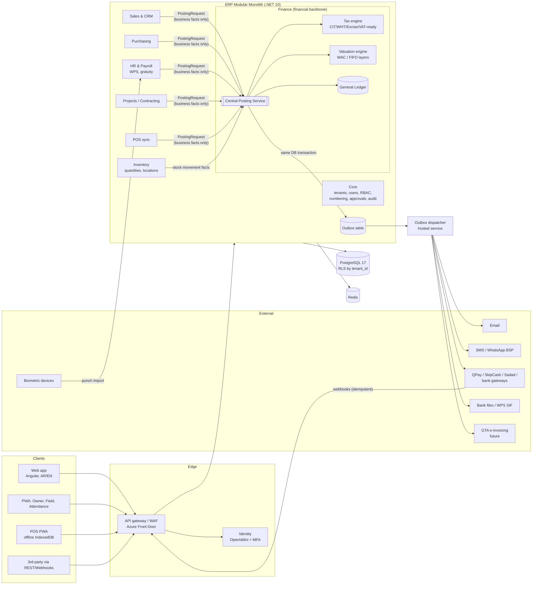
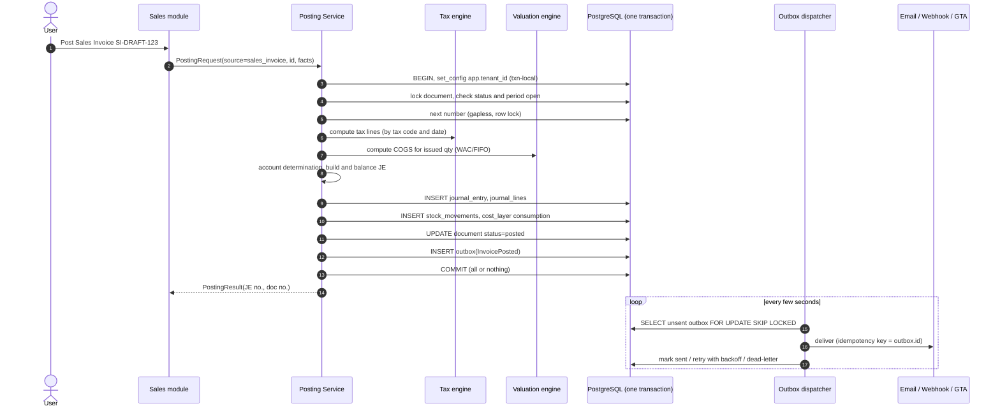
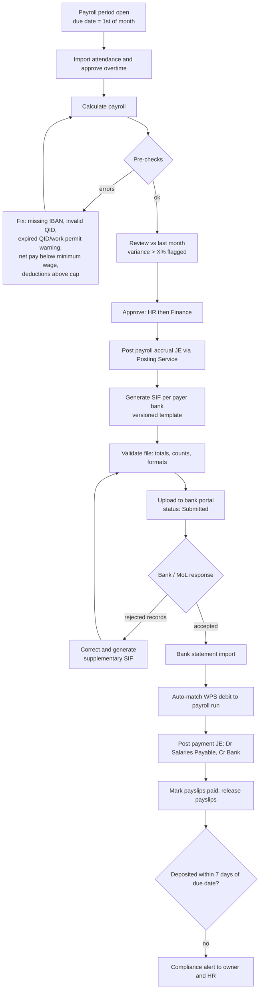
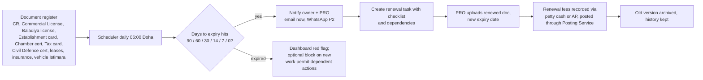
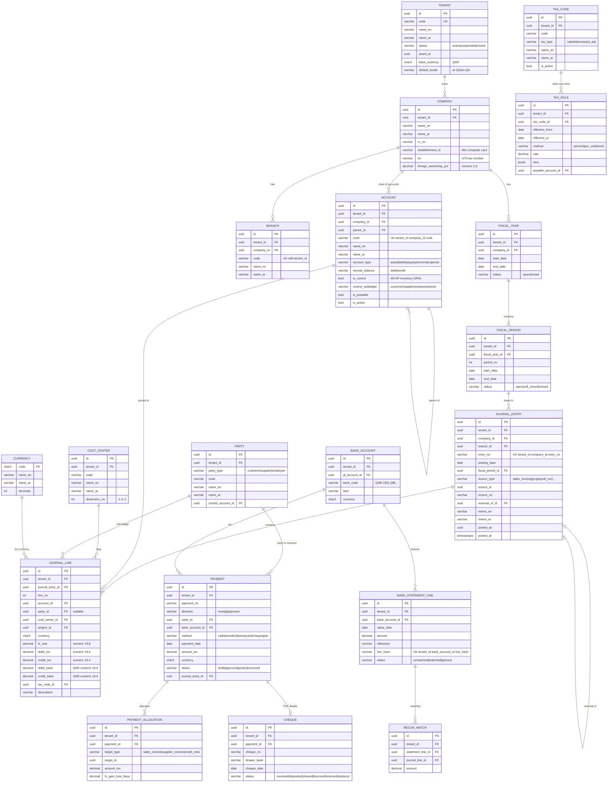
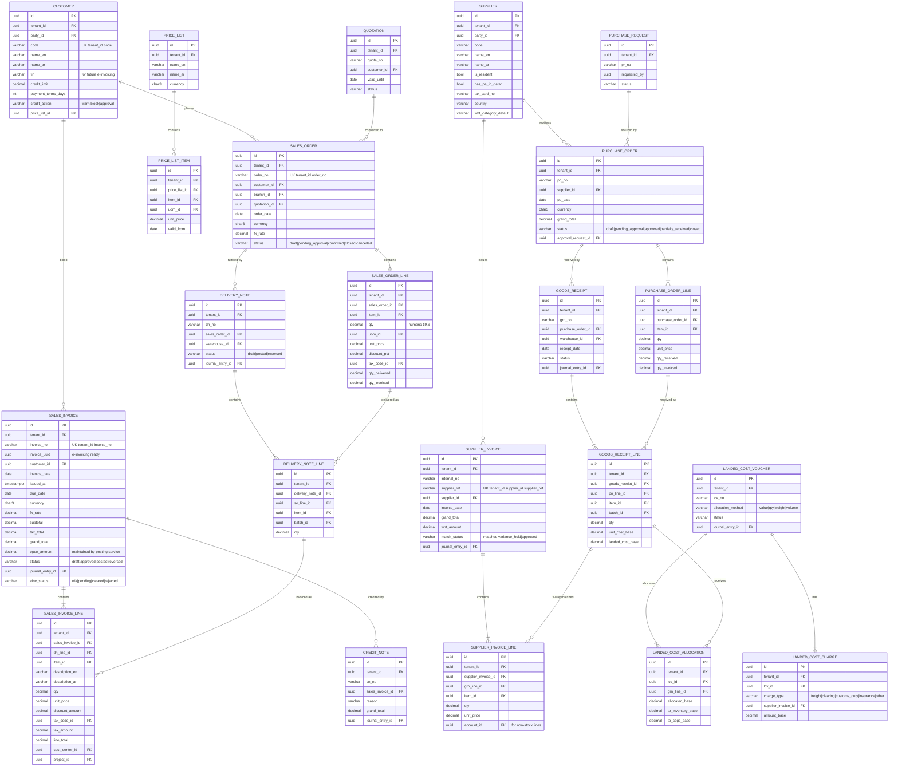
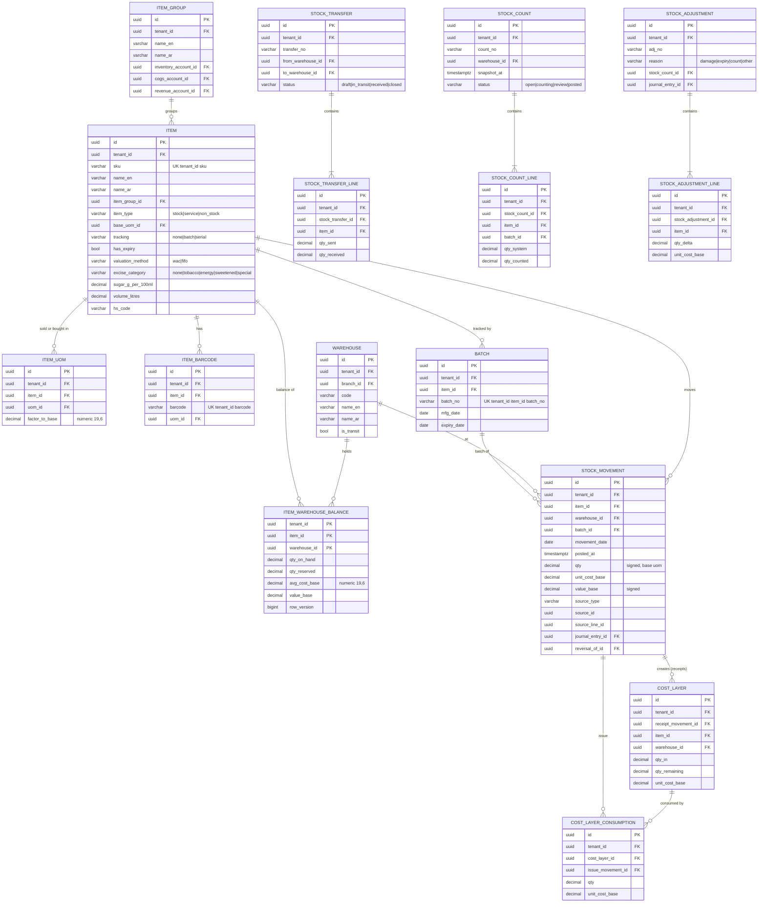
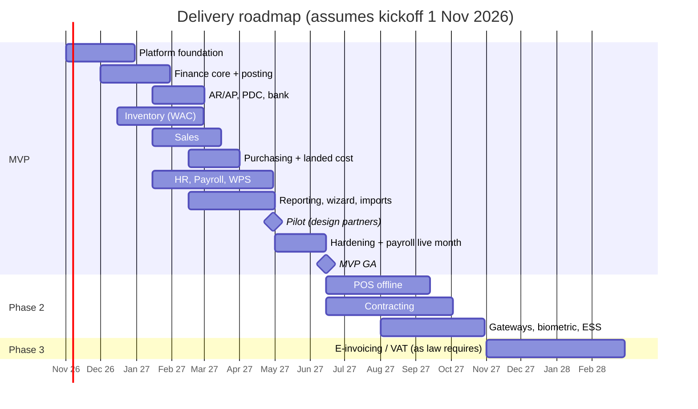

# Qatar SME Cloud ERP — Solution Blueprint

**Status:** Draft v0.1 · **Date:** 17 October 2026 · **Scope:** Product, architecture, localization, data model, delivery plan

> **How to read the regulatory flags.** ⚠️ **VERIFY** marks a Qatari legal, tax or regulatory point that is either uncertain, recently changed, or known only from secondary sources (law-firm alerts, vendor blogs). Every one of these must be confirmed against the primary source (Official Gazette / Al Meezan, GTA, MoL, MoCI, QCB, NCSA) by a Qatari tax adviser and labour lawyer **before** the rule is shipped as a default. The design deliberately makes every such rule a configurable setting so a change in law is a data change, not a code release.

---

## 0. Decisions at a glance

| Decision | Recommendation | One-line reason |
|---|---|---|
| Build approach | **Custom build** (modular monolith), using ERPNext's domain model as a reference, not as a platform | Shared-DB multi-tenancy with RLS, a single atomic posting service, and Qatar-native payroll/WPS are your moat; neither Odoo nor ERPNext gives you these without fighting the framework |
| Architecture | **Modular monolith**, one deployable, strict module boundaries, in-process events + transactional outbox | 4 developers cannot operate microservices; atomic posting across GL + stock is trivial in one DB transaction and painful across services |
| Backend | **.NET 10 (LTS) / ASP.NET Core**, EF Core 10 for writes, Dapper for reports | Strong typing and `decimal` for money, strong GCC talent pool, LTS to Nov 2028 |
| Database | **PostgreSQL 17** (managed: Azure Database for PostgreSQL Flexible Server) | Mature row-level security, no per-core licence cost in multi-tenant SaaS, JSONB for configurable rules |
| Frontend | **Angular** (current LTS, standalone components + signals) with Angular CDK `Directionality`, PrimeNG (MIT) | Enterprise forms, first-class RTL via CDK bidi, one codebase for web + PWA (POS, field, owner app) |
| Cache / queues | **Redis** (cache, rate limits, SignalR backplane); outbox dispatcher as a .NET hosted service | No message broker needed at this scale |
| Hosting | **Azure Qatar Central (Doha)** primary; Google Cloud Doha (`me-central1`) as an alternative | In-country data residency on day one; AWS has no Qatar region (Bahrain/UAE only) ⚠️ VERIFY that the managed PostgreSQL SKU you need is offered in Qatar Central |
| MVP | Core + Finance + Sales + Purchasing + Inventory (weighted average) + Qatar Payroll/WPS + document expiry | These cover trading/distribution and contractors' back office, the two biggest segments |

---

## 1. Executive summary

### 1.1 The problem

Qatar has a large base of trading companies, contractors/subcontractors, showrooms, clinics and restaurants with 10–150 staff. Most run on a mix of **Tally / QuickBooks desktop, Excel payroll, a separate WPS tool from the bank, and WhatsApp for approvals**. Their pain is not "lack of ERP features"; it is:

1. **Payroll compliance risk.** WPS files rejected at month-end, gratuity calculated by hand at exit, QID/visa expiries discovered when an employee is stopped at a checkpoint. The Wage Protection System now requires wages to fall due on the 1st and to be deposited within 7 days (Ministerial Decision No. 50 of 2026, effective 8 Sep 2026 ⚠️ VERIFY against the Gazette text).
2. **Landed cost and margin blindness.** Importers do not load freight, clearing and customs into item cost, so gross margin is wrong.
3. **Cash and cheque chaos.** Post-dated cheques (PDCs) are still a primary credit instrument; bounced cheques and PDC maturities are tracked in Excel.
4. **Arabic-on-paper requirements.** Invoices and many official documents must be in Arabic (Consumer Protection Law No. 8 of 2008 ⚠️ VERIFY current wording), but staff are largely South Asian, Filipino and Arab expatriates working in English.
5. **Tax change ahead.** Qatar has no VAT today, but the Cabinet approved a **draft e-invoicing law** on 6 May 2026 and VAT is repeatedly described as "coming". SMEs need a system that switches these on by configuration.

### 1.2 Why tier-1 and Western SaaS fail here

| Failure mode | SAP / Oracle | Generic Western SaaS (Xero, QuickBooks Online, NetSuite for SMB) |
|---|---|---|
| Cost | Licence + partner implementation of QAR 300k–2M+ per company; consultants billed in USD/EUR | Cheap per user but the Qatar gaps are filled with costly add-ons |
| Payroll | Qatar payroll is a partner add-on; WPS/gratuity are custom work | No Qatar payroll at all; WPS is out of scope |
| Arabic | Arabic UI exists, but bilingual documents and Arabic master data are partner customisations | Arabic UI missing or machine-translated; no Arabic invoice layouts |
| Process fit | Built for 1,000+ users; approval and costing models overwhelm a 30-person trader | No PDC, no retention, no landed cost, no BOQ/progress billing |
| Calendar/locale | Configurable but heavy | Sat–Sun weekend baked in; no Hijri; no Qatar holidays |
| Data residency | On-prem possible but expensive | Data hosted in US/EU; conflicts with sector/NCSA expectations for some customers |
| Support | Partner model; slow for small accounts | No local presence; English-only support |

### 1.3 How this design closes the gap

- **Qatar payroll is core, not an add-on**: WPS SIF generation, monthly gratuity and leave-salary accrual, document expiry, overtime per Labour Law — all posting to the GL through the same posting service.
- **Trading and contracting realities built in**: landed cost, PDC lifecycle, retention, progress billing, 3% contract retention for tax clearance, site expenses from mobile.
- **Arabic-first, bilingual by data model**: every master record has `name_en` / `name_ar`; every printed document can be English, Arabic, or side-by-side bilingual, with the amount in words in both languages (tafqeet).
- **Tax engine ready for change**: CIT, WHT and excise today; VAT and e-invoicing are dormant configurations that can be activated once law and technical specs are final.
- **Priced in QAR for SMEs**: payroll priced **per employee** (not per user) so a contractor with 120 labourers and 6 office users pays fairly.
- **In-country hosting** option from day one.

### 1.4 Competitive positioning

| Competitor | Strength | Weakness in Qatar SME | Our position |
|---|---|---|---|
| **Odoo** (Community/Enterprise) | Breadth, modern UI, large partner network | Full accounting and payroll are Enterprise-only; Qatar localization thin; WPS/gratuity are partner add-ons; heavy customisation breaks upgrades | Deeper Qatar payroll/contracting out of the box, one price that includes localization |
| **Zoho** (Books, Inventory, People) | Low price, good UX | Separate apps glued together; no WPS SIF; no contracting; limited Arabic printing | Single ledger, native WPS, bilingual documents |
| **Microsoft Dynamics 365 Business Central** | Strong accounting, Microsoft ecosystem | ~USD 80–110 per user per month (⚠️ VERIFY current list price), partner-dependent localization, payroll via third parties | ~50–70% lower TCO, payroll included, 30-minute onboarding |
| **Tally Prime + local add-ons** | Incumbent among trading firms, accountants know it | Desktop-first, weak multi-branch/mobile, payroll/WPS via separate tools | Cloud, mobile approvals, Tally import templates and migration as a service |
| **Regional SaaS** (e.g., Wafeq, Daftra, Qoyod) | Arabic-native, cheap, GCC tax-ready | Accounting-centric; limited inventory depth, contracting and Qatar payroll | Full operational ERP (inventory, projects, POS, payroll) with an accounting-grade core |
| **Local Qatar vendors** (on-prem ERP/payroll houses) | Relationships, Arabic support | Older tech, on-prem upgrades, customised per client | Multi-tenant SaaS economics, continuous updates, still offers dedicated/on-prem for larger clients |

### 1.5 Build vs. customise (ERPNext / Odoo)

| Criterion | Custom build | ERPNext (Frappe, GPLv3) | Odoo (LGPL Community / proprietary Enterprise) |
|---|---|---|---|
| Time to first paying customer | Slowest (6–8 months) | Fastest (2–3 months) | Fast (3 months) with Enterprise |
| Shared-DB multi-tenancy with RLS (principle 5) | Native | **No**: one database per site (bench) | **No**: one database per tenant |
| Single atomic posting service (principles 1–2) | Designed in | Partially: each DocType posts its own GL entries in `on_submit` | Partially: `account.move` is central, but stock valuation and accounting interact through many override points |
| Qatar payroll/WPS | Build (≈18 dev-weeks) | HRMS app exists; WPS/gratuity need a custom app | Payroll is Enterprise; WPS/gratuity via partner modules |
| Licence cost to you | None | None (GPL; SaaS use is allowed because GPLv3 is not AGPL) | Enterprise per-user fees reduce your margin; Community lacks full accounting |
| Upgrade risk | You control it | Moderate (yearly major versions) | High for heavily customised Enterprise |
| Differentiation and IP | Full | Low (anyone can deploy ERPNext) | Low |
| Hiring | .NET/Angular widely available in Doha | Python/Frappe specialists are scarce in Qatar | Odoo developers available but expensive |

**Recommendation: custom build**, for three reasons:
1. Your non-negotiables (shared-DB tenancy with RLS, one posting service, immutable ledger) are architecture-level. You would spend the first months fighting Frappe/Odoo internals to get them.
2. The Qatar-specific value (WPS, gratuity, PDC, retention, landed cost, bilingual printing) is where customers decide, and it is roughly 30–40% of the MVP effort either way.
3. A SaaS business needs owned IP and controllable unit economics.

**When to choose ERPNext instead:** if you must have paying customers within **3 months**, or the team cannot add a QA/BA person and a part-time Qatari accountant. In that case, build a "Qatar Pack" Frappe app (WPS, gratuity, PDC, documents) on ERPNext with a database per tenant, and accept the trade-offs above.

### 1.6 Technology stack (justified)

| Layer | Choice | Why / notes |
|---|---|---|
| Runtime | .NET 10 LTS, ASP.NET Core minimal APIs + controllers | LTS support; `decimal` (28–29 significant digits) for money; excellent PostgreSQL support via Npgsql |
| ORM | EF Core 10 (commands), Dapper (reports) | EF for aggregates and transactions; hand-written SQL for heavy reports |
| Mediation / mapping | **Own thin abstractions**; avoid MediatR, AutoMapper and MassTransit, which moved to commercial licences in 2025 | Avoid licence surprises in a SaaS cost base |
| DB | PostgreSQL 17, `numeric(19,4)` money, RLS, `pgcrypto`, partitioning for ledgers | RLS is the second isolation line (principle 5) |
| Identity | ASP.NET Core Identity + OpenIddict (Apache-2.0); TOTP MFA; external login via Microsoft Entra ID / Google | Self-hosted, no per-MAU fees; SSO for larger clients |
| Jobs | Outbox dispatcher (hosted service) + Quartz.NET for schedules (expiry alerts, accruals, PDC maturities) | Simple, transactional |
| Frontend | Angular + PrimeNG + Angular CDK bidi; Transloco for i18n; PWA via Angular service worker | RTL/LTR switch per session; one codebase for POS, field and owner apps |
| Offline | IndexedDB (Dexie.js) in the PWA for POS and field expenses | POS keeps selling during an internet outage |
| PDF | QuestPDF (community licence is free under USD 1M revenue; ⚠️ check the licence terms when you exceed that) with HarfBuzz-shaped Arabic fonts (e.g., Noto Naskh/IBM Plex Sans Arabic) | Correct Arabic shaping and bidi in printouts |
| Excel | ClosedXML (MIT) | Import templates and exports |
| Observability | OpenTelemetry → Azure Monitor / Grafana; Serilog with `tenant_id` enrichment | Per-tenant traceability |
| CI/CD | GitHub Actions, Testcontainers for PostgreSQL integration tests, Playwright E2E (RTL + LTR runs) | Isolation and posting tests run on every PR |

**Why not FastAPI:** perfectly viable (Python `Decimal` is fine), but .NET gives stronger compile-time safety for a large accounting domain, better raw performance per server, and a deeper hiring pool in the GCC enterprise market. **Why not SQL Server:** per-core licensing hurts SaaS margins, and PostgreSQL RLS is simpler to reason about for tenant isolation.

---

## 2. Architecture

### 2.1 Modular monolith vs. microservices

| Factor | Modular monolith | Microservices |
|---|---|---|
| Team of 4 | One repo, one pipeline, one deployment | Each service needs pipelines, observability and on-call; overhead exceeds team capacity |
| Atomic posting (GL + stock + document) | One DB transaction | Sagas/compensation; violates "posted only if all succeed" unless you add 2PC |
| Reporting across modules | SQL joins | Data duplication / CQRS read models |
| Future scale | Extract hot modules later (POS sync, integrations hub, reporting) | Already split |

**Decision: modular monolith.** Each module (Core, Finance, Sales, Purchasing, Inventory, HR, Projects, POS) is a separate .NET project with:
- its own schema (`fin`, `sales`, `inv`, `hr`, …) in the same PostgreSQL database;
- a public contract (`*.Contracts` project: commands, queries, integration events); other modules may reference **only** the contracts, enforced with architecture tests (NetArchTest);
- no direct writes to another module's tables.

Candidates for extraction later: **POS sync gateway**, **Integration hub** (gateways, banks, e-invoicing), **Reporting replica** (read replica + materialised views).

### 2.2 Logical architecture



### 2.3 The central posting service

**Contract.** Operational modules never compute account codes, tax amounts, or inventory cost. They submit a **PostingRequest** containing business facts (party, items, quantities, unit prices, discounts, tax codes, warehouse, cost centre, project, currency, document date). The posting service:

1. Validates the fiscal period is open for the document date and module.
2. Locks the source document row (`SELECT … FOR UPDATE`) and checks it is still `approved`/`draft` (idempotency: a second post returns the existing result).
3. Assigns the final document number from a gapless sequence (row lock on `core.number_sequence`).
4. Calls the **Tax engine** (tax lines), **Valuation engine** (cost for issues, layer creation for receipts), and **Account determination** (posting rules per tenant: item group × warehouse × transaction type → accounts).
5. Builds journal lines; asserts `Σ debit = Σ credit` in base currency **and** in each transaction currency; rounds to currency precision and posts rounding differences to a configured rounding account.
6. Inserts `journal_entry`, `journal_line`, `stock_movement`, `cost_layer` rows; sets document `status = posted`, `posted_at`, `journal_entry_id`.
7. Inserts outbox messages (e.g., `InvoicePosted` → email PDF, webhook, future e-invoice submission).
8. Commits. **Either everything above is committed or nothing is.**



**Reversal.** `PostingService.Reverse(source, reason, reversalDate)` creates a mirror journal entry (`reversal_of_id` set), reverses stock movements at original cost, and marks the document `reversed`. Credit notes, returns and adjustments are separate documents posted through the same service.

**Concurrency and performance.**
- Posting is per document; batch posting (payroll, depreciation) uses one transaction per batch with a configurable chunk size.
- Inventory valuation locks the `item_warehouse_balance` row for each item touched, in a deterministic order (sorted by item id) to avoid deadlocks.
- Back-dated postings that affect WAC trigger a **revaluation job** (recompute COGS from the back-date forward, posting adjustment entries, never editing old lines). A tenant setting can block back-dating beyond N days.

### 2.4 Outbox pattern

`core.outbox_message(id uuid, tenant_id, type, payload jsonb, created_at, available_at, attempts, last_error, sent_at, dead_lettered_at)`

- Written in the same transaction as the business change.
- Dispatcher uses `FOR UPDATE SKIP LOCKED` (safe with several app instances).
- At-least-once delivery; consumers and external calls use `outbox.id` as the idempotency key.
- Exponential backoff (1 min → 6 h), dead-letter after N attempts, visible in an admin "Integration monitor" with a retry button.
- **Inbound** webhooks (payment gateways, banks) go to an **inbox** table with a unique `(provider, external_event_id)` constraint, so duplicates are ignored.

### 2.5 Multi-tenancy and deployment models

| Model | Who | How |
|---|---|---|
| Shared (default) | Most SMEs | Shared DB, `tenant_id` + RLS; tenants assigned to a **shard** (DB server) by `tenant_registry.shard_id` so you can rebalance later |
| Dedicated | Larger or regulated clients (clinics, government contractors) | Same build, own database (and optionally own app instance) in Azure Qatar Central |
| Hybrid | Clients with site servers | Cloud ERP plus an on-prem POS/attendance edge node that syncs |
| On-premise | Rare; priced high | Docker Compose / Kubernetes bundle; customer-managed PostgreSQL; updates quarterly |

Because tenancy is always enforced by `tenant_id` + RLS, a dedicated database is simply a shard with one tenant — **one codebase for all models**.

---

## 3. Module matrix and phasing

### 3.1 Bundles

| Bundle | Modules | Who buys |
|---|---|---|
| **Core (always on)** | Platform, Finance & Accounting, Reporting basics | Everyone |
| **Trade** | Sales, Purchasing, Inventory | Traders, distributors, showrooms |
| **People** | HR, Payroll (WPS), Attendance, ESS | Everyone with staff; contractors first |
| **Retail** | POS (multi-branch, offline) | Retail, restaurants, showrooms |
| **Contracting** | Projects, BOQ, progress billing, retention, subcontractors | Contractors and subcontractors |
| **Services** (Phase 3) | Appointments, service orders, packages | Clinics, salons, maintenance companies |

### 3.2 Phasing

| Module | MVP (M1–M6/7) | Phase 2 (M7–M12) | Phase 3 (M13–M18) |
|---|---|---|---|
| Core | Tenants, branches, users, roles/permissions, approvals (amount-based), numbering, audit, email notifications, module toggles, basic subscription | SMS + WhatsApp Business notifications, SSO, delegation of approvals, self-serve billing with card payment | Platform marketplace, partner (reseller) portal |
| Finance | COA (bilingual IFRS template), opening balances, GL, AR/AP with allocations, cost centres, bank & cash, **PDC**, period close, tax engine (CIT/WHT/excise data), FS | Fixed assets, budgeting, bank statement import with auto-matching rules, cash-flow forecast, multi-company consolidation (same tenant) | VAT activation, e-invoicing adapter, IFRS 16 leases |
| Sales & CRM | Customers, quotations, sales orders, delivery notes, invoices, returns/credit notes, statements, credit limits, price lists | Leads/opportunities pipeline, promotions, sales commissions, customer portal | E-commerce connectors |
| Purchasing | PR → PO (with approval) → GRN → supplier invoice, returns, 3-way match, **basic landed cost** (by value/qty) | RFQ & quotation comparison, landed cost by weight/volume, blanket POs, supplier portal | Import shipment tracking |
| Inventory | Multi-warehouse, **weighted average**, transfers, adjustments, stock counts, barcodes, **batch + expiry** | FIFO, serial numbers, bins, reorder planning, kits/bundles | Manufacturing-lite (BOM assembly) |
| HR & Payroll | Employees, contracts, documents & expiry, leave, payroll, overtime, loans/advances, **gratuity & leave accrual**, **WPS SIF**, final settlement, attendance import (CSV) | Biometric integration (ZKTeco etc.), ESS app, shift rosters, air-ticket accrual, GRSIA reports for Qatari staff | Recruitment, performance, training |
| Projects/contracting | — | BOQ, budgets, progress billing, retention, subcontractor certificates, site expenses (mobile), 3% tax retention | Equipment/plant costing, variation orders workflow |
| POS | — | Offline PWA, multi-branch, shifts/Z-report, card terminals | Loyalty, restaurant (KOT, tables) |
| Mobile/PWA | Owner dashboard (read-only), approvals | Field expenses with receipt photo, attendance with geofence, ESS | Native wrappers (Capacitor) if needed |
| Reporting | TB, P&L, BS, GL detail, AR/AP aging, stock balance/valuation, payroll register, Excel/PDF export | Role dashboards, KPI library, saved filters, scheduled email reports | Report builder, BI connector (Power BI) |
| Integrations | Excel import/export, WPS file, REST API (read) | Payment gateways, bank statement formats, webhooks, biometric | GTA e-invoicing, e-commerce, bank host-to-host |

### 3.3 Deferred from MVP (explicit)

1. POS (whole module) — Phase 2
2. Projects/contracting (whole module) — Phase 2; contractors use cost centres + project tags in MVP
3. FIFO valuation and serial numbers (WAC + batch/expiry only in MVP)
4. Fixed assets and depreciation
5. Budgeting and cash-flow forecasting
6. Biometric device integration (CSV import of punches only)
7. Payment gateway integrations and automatic bank feeds (manual bank statement import with matching is in MVP)
8. SMS/WhatsApp notifications (email only)
9. CRM leads/opportunities
10. Report builder and BI
11. RFQ comparison
12. ESS mobile app (HR enters leave on behalf of employees)
13. VAT and e-invoicing **activation** (the data model and tax engine hooks are in MVP)
14. SSO with external IdPs (MFA is in MVP)
15. Self-serve card billing for the SaaS subscription (invoiced manually)
16. Multi-company consolidation

---

## 4. Module specifications

> Convention for every module: all monetary fields `numeric(19,4)`; all master data bilingual; every posted document carries `journal_entry_id`; every list is filterable by branch and exportable to Excel.

### 4.1 Core platform

| Aspect | Specification |
|---|---|
| Purpose | Tenancy, identity, permissions, configuration, workflow and audit shared by all modules |
| MVP | Tenant registry; company profile (CR no., establishment card no., TIN, logo, bilingual address); branches; users; roles; permission sets; approval rules; numbering; audit log; email notifications; module activation per subscription |
| Later | SMS/WhatsApp, SSO, approval delegation, self-serve billing, partner portal |
| Entities | `tenant`, `company`, `branch`, `app_user`, `role`, `permission`, `role_permission`, `user_role`, `field_policy`, `approval_rule`, `approval_step`, `approval_request`, `number_sequence`, `audit_log`, `notification`, `outbox_message`, `inbox_message`, `subscription`, `plan`, `module_entitlement`, `setting` |
| Workflows | Tenant provisioning (wizard) → seed COA, tax codes, numbering, roles. Approval: document submit → rule match (doc type, amount range, branch, cost centre) → steps (sequential/any-of) → approve/reject with comment → document becomes `approved` |
| Reports | User access review, audit trail by document/user/date, login history, approval turnaround |
| Acceptance criteria | (1) User of tenant A cannot read/write any row of tenant B via UI, API or report, verified by the automated isolation suite. (2) PO of QAR 49,999 needs 1 approval and QAR 50,000 needs 2 when rules are configured that way. (3) Numbering has no gaps or duplicates under 50 concurrent posts. (4) Every change to master data and every post/reversal appears in the audit log with old and new values, user, IP and timestamp. (5) Disabling a module hides its menus and returns 403 on its APIs without data loss. |

**Permission model.** `permission = resource × action` (e.g., `sales_invoice:create|read|update|post|reverse|print|export`), optional **data scope** (own / branch / all branches / specific cost centres) and **field policies** (e.g., `item.cost_price: hidden` for sales role; `employee.salary: hidden` except HR/payroll). Roles are bundles of permissions; job titles are only labels. Segregation-of-duties rules: a user cannot approve a document they created (configurable), and cannot both create a supplier and post payments to it (warning or block).

### 4.2 Finance and accounting

| Aspect | Specification |
|---|---|
| Purpose | The financial backbone; only module that writes the GL |
| MVP | Bilingual COA with control accounts & normal balance; opening balances (GL, AR, AP, stock, PDC, employee gratuity); journal vouchers; AR/AP with allocations (invoice ↔ payment ↔ credit note, partial and multi-invoice); cost centres (2 dimensions + project tag); bank & cash accounts; receipts/payments; **PDC received/issued**; bank statement import (CSV/Excel/MT940 where available) with matching; multi-currency with revaluation; period & year close; tax engine; FS |
| Later | Fixed assets, budgets, cash-flow forecast, consolidation, VAT/e-invoicing activation, IFRS 16 |
| Entities | `account`, `account_group`, `fiscal_year`, `fiscal_period`, `period_module_lock`, `journal_entry`, `journal_line`, `cost_center`, `currency`, `exchange_rate`, `party` (customer/supplier/employee as AR/AP sub-ledger), `payment`, `payment_allocation`, `cheque` (PDC), `bank_account`, `bank_statement`, `bank_statement_line`, `reconciliation_match`, `tax_code`, `tax_rule`, `tax_line`, `posting_rule` |
| Key workflows | **PDC received:** receipt with cheque details → Dr PDC Receivable / Cr Customer → on maturity date, deposit → Dr Bank Clearing / Cr PDC Receivable → bank statement match clears → if bounced: reverse deposit, Dr Customer / Cr PDC, charge bounce fee, flag customer, optional credit block. **PDC issued** is the mirror via PDC Payable. **Bank reconciliation:** import statement → hash each line (`account + date + amount + reference + running balance`) and reject duplicates → auto-match rules (amount + reference, cheque no., WPS batch) → user confirms → unmatched lines create receipts/payments/bank charges through the posting service. **Period close:** checklist (unposted drafts, unreconciled bank, PDCs past maturity, FX revaluation, accruals for gratuity/leave posted) → close module by module → close period → year-end closing entry to retained earnings |
| Reports | TB (with opening/movement/closing), GL detail, P&L, Balance Sheet, cash-flow (indirect), AR/AP aging (by due date and by document date), customer/supplier statements (bilingual), PDC register & maturity calendar, bank reconciliation report, cost-centre P&L, journal audit report |
| Acceptance criteria | (1) Every journal entry balances in base currency to 0.0000 and in each transaction currency. (2) A posted journal line cannot be updated or deleted by the app role (DB rejects it). (3) Posting to a closed period is rejected unless the user has `period:override` and the period is soft-closed. (4) Importing the same bank statement twice creates zero new lines. (5) AR control account balance = Σ open customer balances at any date (automated reconciliation report). (6) Reversing a payment restores invoice open amounts exactly. (7) TB from the ledger matches TB from the reporting replica. |

### 4.3 Sales and CRM

| Aspect | Specification |
|---|---|
| Purpose | Quote-to-cash |
| MVP | Customers (bilingual, credit limit, payment terms, salesperson, price list), quotations, sales orders, delivery notes (stock issue), invoices (against DN or direct), returns & credit notes, receipts, statements, price lists, discounts, credit-limit control |
| Later | Leads/opportunities, promotions, commissions, customer portal, e-commerce |
| Entities | `customer`, `customer_contact`, `price_list`, `price_list_item`, `quotation(+_line)`, `sales_order(+_line)`, `delivery_note(+_line)`, `sales_invoice(+_line)`, `sales_return(+_line)`, `credit_note` |
| Workflows | Quote → SO (converts with one click, keeps link) → DN (partial deliveries, posts stock issue: Dr COGS / Cr Inventory) → Invoice (Dr AR / Cr Revenue / Cr tax) → Receipt (cash, card, transfer, Fawran, PDC). Credit check at SO and DN: overdue > N days or balance + order > limit → block or route to approval |
| Reports | Sales by item/customer/salesperson/branch, gross margin by invoice (uses posted COGS, not current cost), open orders, undelivered/uninvoiced DNs, customer aging, statement of account |
| Acceptance criteria | (1) Invoicing a DN does not issue stock again. (2) A return of 3 out of 10 units restores stock at the original issue cost and posts a credit note linked to the invoice. (3) An order exceeding the credit limit cannot be confirmed without approval when the setting is "block". (4) Invoice PDF prints in EN, AR or bilingual with the amount in words in both languages. (5) Margin report equals revenue minus COGS from the GL for the same filters. |

### 4.4 Purchasing

| Aspect | Specification |
|---|---|
| Purpose | Procure-to-pay with control |
| MVP | Purchase requests, POs with amount-based approvals, GRN (stock receipt), supplier invoices, returns, 3-way match (PO–GRN–invoice) with tolerances, landed cost vouchers (freight, clearing, customs duty, insurance) allocated by value or quantity, WHT for non-resident suppliers |
| Later | RFQs and comparison, blanket POs, landed cost by weight/volume, supplier portal, import shipment tracking |
| Entities | `supplier`, `purchase_request(+_line)`, `rfq`, `purchase_order(+_line)`, `goods_receipt(+_line)`, `supplier_invoice(+_line)`, `purchase_return(+_line)`, `landed_cost_voucher`, `landed_cost_charge`, `landed_cost_allocation` |
| Workflows | **3-way match:** GRN posts Dr Inventory / Cr GRNI (goods received not invoiced) at PO price → supplier invoice clears GRNI; price difference within tolerance → purchase price variance (or to inventory if still in stock, per setting); outside tolerance → invoice held for approval. **Landed cost:** voucher references one or more GRNs and supplier invoices for charges → allocation by value/qty → posts Dr Inventory (for qty still on hand) and Dr COGS (for qty already sold) / Cr Landed Cost Clearing; customs duty paid via clearing agent is captured as a charge line |
| Reports | Open POs, GRNI aging, purchase price variance, supplier aging, landed cost per shipment, spend by supplier/category |
| Acceptance criteria | (1) Sum of allocated landed costs = sum of charges, to the dirham. (2) After landed cost, item WAC reflects the charges for qty on hand; the portion for sold qty goes to COGS. (3) GRNI account balance = Σ received-not-invoiced value report. (4) A supplier invoice above PO price + tolerance cannot be posted without approval. (5) WHT is withheld on payments to suppliers flagged non-resident without a PE, and appears on the WHT return report. |

### 4.5 Inventory

| Aspect | Specification |
|---|---|
| Purpose | Accurate quantities and cost by warehouse |
| MVP | Items (bilingual, units with conversions, barcodes, item groups, excise category), warehouses (per branch), stock movements, **weighted average cost per item per company** (option: per warehouse), transfers (in-transit), adjustments with reasons, stock counts (freeze, count sheets/mobile scan, variance posting), batch & expiry, reorder level |
| Later | FIFO, serials, bins, reorder suggestions, kits, assembly |
| Entities | `item`, `item_group`, `uom`, `item_uom`, `item_barcode`, `warehouse`, `stock_movement` (immutable), `item_warehouse_balance`, `cost_layer` (for FIFO; also used for batch costing), `batch`, `stock_transfer(+_line)`, `stock_adjustment(+_line)`, `stock_count(+_line)` |
| Workflows | Transfer: issue from WH-A to In-Transit → receive in WH-B (partial receipts allowed, differences to "transfer loss" with approval). Stock count: create count → freeze snapshot → count via mobile scanning → review variances → post adjustment (Dr/Cr Inventory vs Stock Variance) |
| Reports | Stock balance (qty/value) by warehouse, stock ledger by item, valuation report (must equal Inventory GL), slow-moving/ageing, expiry report (next 30/60/90 days), reorder report |
| Acceptance criteria | (1) Stock valuation report = Inventory control account balance at any date. (2) Negative stock is blocked unless the tenant allows it (then cost uses last WAC and is trued up on receipt). (3) Expired batches cannot be issued unless the user has override permission. (4) Stock count variance posting creates one adjustment document traceable to the count. (5) Concurrent issues of the last unit from two sessions: exactly one succeeds. |

### 4.6 HR and payroll (Qatar)

| Aspect | Specification |
|---|---|
| Purpose | Compliant Qatar payroll and workforce documents |
| MVP | Employees (bilingual names as on QID; nationality; QID; passport; visa; work permit; health card; bank IBAN), contracts (basic, housing, transport, food, other allowances, accommodation provided Y/N), departments, cost centres/projects, leave types & balances, leave requests (entered by HR), attendance import (CSV from devices), overtime, loans/advances with instalments, monthly payroll run, gratuity & leave-salary accrual, WPS SIF, final settlement, payslips (EN/AR) |
| Later | Biometric live integration, ESS (leave, payslips, letters), rosters/shifts, air-ticket accrual automation, GRSIA contribution reporting, recruitment, appraisal |
| Entities | `employee`, `employee_document`, `employment_contract`, `contract_component`, `pay_component`, `leave_type`, `leave_policy`, `leave_balance`, `leave_request`, `attendance_punch`, `attendance_day`, `overtime_entry`, `loan`, `loan_instalment`, `payroll_run`, `payslip`, `payslip_line`, `gratuity_accrual`, `leave_accrual`, `wps_file`, `final_settlement`, `holiday_calendar` |
| Workflows | See §5 (WPS, gratuity). Payroll run: open period → import attendance → approve overtime → calculate → review variances vs last month → approve (2-step) → post accrual JE (Dr salary expense by cost centre / Cr Salaries Payable, Cr loan recovery) → generate SIF → upload → mark paid on bank match (Dr Salaries Payable / Cr Bank) |
| Reports | Payroll register, cost by project/cost centre, gratuity liability schedule, leave liability, document expiry, headcount by nationality, WPS reconciliation (file vs bank debit vs payroll), loan balances |
| Acceptance criteria | (1) Gratuity provision at month-end = Σ per-employee calculated liability (to the dirham). (2) SIF file validates against the bank's spec validator (header totals = sum of records; IBAN and QID formats valid). (3) Net pay = earnings − deductions, and deductions never exceed the legal cap (configurable, default 50% of wage ⚠️ VERIFY). (4) An employee with an expired QID shows on the payroll pre-check as a warning. (5) Final settlement for a test case matches a manual calculation approved by the payroll SME. |

### 4.7 Projects / contracting (Phase 2)

| Aspect | Specification |
|---|---|
| Purpose | Job costing and contract billing for contractors and subcontractors |
| Features | Projects (main contract value, client, consultant), BOQ (sections, items, qty, rate, bilingual descriptions), budgets by BOQ item/cost type, progress measurement (% or qty), **progress billing (interim payment applications)** with cumulative-to-date logic, **retention** (e.g., 5–10% receivable/payable, release at handover/DLP end), advance payment and recovery, subcontractor agreements and payment certificates, site expenses from mobile with receipt photos (OCR Phase 3), variation orders, **3% tax retention** on payments to contractors without tax clearance (⚠️ VERIFY current rule and threshold under the Income Tax Law and Executive Regulations) |
| Entities | `project`, `boq_section`, `boq_item`, `project_budget`, `progress_measurement`, `progress_invoice(+_line)`, `retention_ledger`, `subcontract`, `subcontract_certificate`, `site_expense`, `variation_order` |
| Postings | Progress invoice: Dr AR (net), Dr Retention Receivable, Dr Advance Recovery / Cr Contract Revenue (or Cr Billings in Excess if using % completion — configurable). Subcontractor certificate: mirror on AP with Retention Payable |
| Reports | Project P&L, budget vs actual by cost type, cost-to-complete, retention receivable/payable schedule, WIP, subcontractor statement |
| Acceptance criteria | Cumulative billed = Σ certified to date; retention balance per project ties to GL; a site expense uploaded offline syncs once (no duplicates) and posts with its photo attached |

### 4.8 POS (Phase 2)

| Aspect | Specification |
|---|---|
| Features | PWA on tablet/PC, barcode scanner, receipt printer (ESC/POS via local bridge or WebUSB), cash drawer; shift open/close with cash count; offline sales stored in IndexedDB and synced; per-device number blocks (e.g., `POS-DOH1-T2-000123`) so offline numbering never collides; card terminal integration (bank-provided ECR protocols ⚠️ per bank); returns with receipt lookup; Z-report |
| Posting | Each synced sale is a POS document posted via the posting service; end-of-shift summary posts cash/card clearing. Inventory issues at sync time with the sale's timestamp |
| Acceptance criteria | Disconnect network, sell 200 items, reconnect: all sales sync exactly once, stock and GL match; two terminals selling the last unit offline → second sync creates negative stock alert, not a lost sale |

### 4.9 Mobile / PWA

| App | Users | MVP / Phase 2 features |
|---|---|---|
| Owner | Owner, GM | MVP: cash & bank position, today's sales, AR overdue, approvals inbox. P2: push notifications, PDC due this week |
| Field | Site staff, salespeople | P2: site expense with photo, offline queue; stock receipt by scan; customer visit log |
| Attendance | Labour, staff | P2: geofenced check-in/out with selfie (opt-in, PDPPL consent), shift view |
| ESS | All employees | P2: payslips, leave requests, document expiry reminders, letters (salary certificate) in AR/EN; UI also in Hindi, Urdu, Malayalam, Nepali, Tagalog, Bengali (translation table, Phase 2) |

### 4.10 Reporting and BI

- **MVP:** standard financial set (TB, P&L, BS, cash flow, GL detail), aging, stock valuation, sales/purchase analysis, payroll register; every report: bilingual headers, period comparison, drill-down from report line → journal entry → source document → stock movements/payments; export to Excel (ClosedXML) and PDF.
- **Phase 2:** role dashboards (owner, accountant, sales manager, storekeeper, HR), KPI library (DSO, DPO, gross margin %, stock turns, overdue %, payroll cost per project), scheduled e-mail reports.
- **Phase 3:** report builder on curated semantic views (no raw table access), Power BI connector over a per-tenant secured view.
- **Acceptance:** each financial statement figure drills down to source documents, and the drill-down total equals the figure.

### 4.11 Integrations

| Integration | Phase | Approach |
|---|---|---|
| WPS SIF | MVP | Versioned file generator (see §5.1); manual upload to bank portal; host-to-host later |
| Bank statements | MVP | CSV/Excel templates per bank (QNB, CBQ, QIB, Doha Bank, Dukhan Bank, QIIB …), MT940/CAMT.053 where offered |
| Payment gateways | P2 | Adapter interface `IPaymentGateway` (create payment link, verify webhook signature, query status). Providers: QPay (national e-commerce gateway, also supports Fawran), SkipCash, Sadad, Dibsy, bank MPGS gateways (QNB/CBQ/QIB). Webhooks via inbox table (idempotent) |
| Instant transfers | P2 | Fawran references captured on receipts for auto-matching in bank reconciliation |
| Biometric | P2 | ZKTeco (push SDK/ADMS) and Suprema via an on-prem connector agent or vendor cloud API; CSV import in MVP |
| E-commerce | P3 | Shopify/WooCommerce/Salla connectors (orders → sales orders, stock sync) |
| E-invoicing (GTA) | P3 (or earlier if mandated) | `IEInvoiceProvider` adapter fed by the outbox; invoice data model already holds the expected fields (see §5.3) |
| Public API | MVP (read), P2 (write) | REST, OAuth2 client credentials per tenant, scoped permissions, rate limits, webhooks with HMAC signatures |

---

## 5. Qatar localization blueprint

### 5.0 Regulatory status table (as researched October 2026)

| Topic | Current position | Design response | Flag |
|---|---|---|---|
| VAT | Not implemented; GCC framework signed; no date announced | Tax engine supports VAT codes, reverse charge, place-of-supply, tax invoices — **disabled** | ⚠️ VERIFY at each release |
| E-invoicing | Cabinet approved a **draft** e-invoicing law and regulations on 6 May 2026; not yet in force; analysts expect a phased start (large taxpayers first), possibly from 2027 — no official date or technical spec | Data model holds seller/buyer TIN, UUID, issue time, invoice type, credit-note links, hash/QR placeholders; provider adapter in Phase 3 or earlier | ⚠️ VERIFY: monitor GTA/Dhareeba announcements |
| Corporate income tax | 10% on the taxable share of profits of non-Qatari/non-GCC ownership (Income Tax Law No. 24 of 2018 as amended); returns due within 4 months of year-end; Pillar Two 15% domestic minimum tax for groups with revenue ≥ EUR 750M (not relevant to most SMEs) | Ownership % on company profile, tax mapping of accounts, return pack | ⚠️ VERIFY filing obligations for fully Qatari-owned entities and audit thresholds |
| Withholding tax | Applies to payments to non-residents without a PE in Qatar for services, royalties, interest, commissions etc. Recent summaries show a **unified 5% rate**; historically 5% (royalties, technical fees) and 7% (interest, commissions, other services). Due by the 16th of the following month. Since Nov 2025, WHT forms include a contract-notification reference; contracts with non-residents must be notified within 30 days. Treaty rates at source for "approved debtors" (2026 amendment to the Executive Regulations) | Rate table per payment type with effective dates; contract notification tracker | ⚠️ VERIFY rates per payment type with adviser |
| Excise | Tobacco, energy drinks, special-purpose goods (100%); **sugar-sweetened drinks moved to a tiered, sugar-content-based per-litre tax from 6 July 2026** (Law No. 2 of 2026; reported tiers: < 5 g/100 ml exempt, 5–7.99 g QAR 0.77/L, ≥ 8 g QAR 1.06/L) | Excise category, sugar g/100 ml and volume per item; ad-valorem and specific-rate methods | ⚠️ VERIFY tier values (only secondary source lists them) |
| WPS | Ministerial Decision No. 4 of 2015, amended by **Decision No. 50 of 2026** (effective 8 Sep 2026): monthly wages due on the 1st, deposit within 7 days via WPS | Payroll calendar with due date + deadline alerts | ⚠️ VERIFY Gazette text |
| Labour law | Law No. 14 of 2004 as amended; minimum wage QAR 1,000 basic + QAR 500 housing + QAR 300 food if not provided (Law No. 17 of 2020); Law No. 9 of 2026 reportedly changed gratuity dispute routes, not the formula; 2026 amendments reportedly cover part-time/freelance workers | All rates/thresholds as policy settings | ⚠️ VERIFY 2026 amendments |
| Social insurance (Qataris) | Law No. 1 of 2022 (effective 3 Jan 2023 per most sources): employer 14%, employee 7% of contribution salary (basic + social + housing allowance, with caps); GCC nationals follow home-country schemes | Contribution component with base definition and caps | ⚠️ VERIFY caps and GCC rates |
| Company licences | CR and Commercial License via MoCI Single Window; Baladiya (municipality) licence tied to premises; Establishment (computer) card via MoI; Qatar Chamber membership | Document register with renewal workflows | ⚠️ VERIFY whether licensing steps have been merged in your clients' sectors |
| Data protection | PDPPL (Law No. 13 of 2016) + NCSA guidelines (National Information Assurance standards, cloud policy) | Consent, DSR tooling, breach process, in-country hosting option | ⚠️ VERIFY sector-specific residency rules (health: MoPH; finance: QCB) |

### 5.1 WPS workflow



**SIF generator specification (data-driven).**
- Store each accepted SIF layout as a versioned template (`wps_format(version, bank_code, header_fields[], record_fields[], filename_pattern, encoding, delimiter)`), so a spec change is a data change.
- Format per the QCB WPS spec: CSV per RFC 4180, fixed field order, optional `SIF Version` header field (empty = 0).
- **Header (per QCB spec):** Employer EID (establishment ID), File Creation Date, File Creation Time, Payer EID, Payer QID, Payer Bank Short Name, Payer IBAN, Salary Year-Month, Total Salaries, Total Records, SIF Version.
- **Record:** Employee QID, Employee Visa ID (if no QID), Employee Name, Employee Bank Short Name, Employee Account (IBAN), Salary Frequency (M/B), Number of Working Days, Net Salary, Basic Salary, Extra Hours, Extra Income, Deductions, Payment Type, Notes; newer versions add allowance breakdown (housing, food, transport, overtime) and a deduction reason code.
- ⚠️ **VERIFY** the exact current field list, filename convention and accepted version with each payer bank; banks publish their own validators — make passing them a release gate.
- Validations: Qatari IBAN = `QA` + 2 check digits + 4-letter bank code + 21 alphanumerics (29 chars, mod-97 check); QID = 11 digits; `Net = Basic + Extra Income + Overtime − Deductions` per record; header totals = Σ records; one file per payer account.
- Employees not paid through WPS (e.g., excluded categories) must be explicitly flagged with a reason; the default is "all employees in WPS".

### 5.2 Gratuity (end-of-service benefit) accrual

**Legal baseline (Labour Law Art. 54):** at least **3 weeks' basic wage for each year of service**, for service of at least 1 year, pro rata for part-years, based on the **last basic wage**. Contracts may grant more (e.g., 30 days/year). Qataris covered by GRSIA follow the social insurance law instead. ⚠️ VERIFY treatment of unpaid leave days in service, and the daily-wage divisor.

**Policy settings (per tenant, overridable per contract):**

| Setting | Default | Notes |
|---|---|---|
| Basis | Basic wage | Option: basic + listed fixed allowances (contractual) |
| Days per year | 21 | 3 weeks; contract may set 30 |
| Daily wage divisor | 30 | Some employers use 365/12 or 26 ⚠️ VERIFY |
| Minimum service for entitlement | 12 months | Accrual still starts from day 1 (IAS 19 obligation) |
| Exclude unpaid leave from service | Yes | Configurable |
| Excluded nationalities | Qatari (GRSIA) | GCC per home scheme |

**Monthly process (scheduled job, posted via the posting service on the payroll period end date):**

```
service_years(t)   = (t − joining_date − excluded_unpaid_days) / 365
liability(t)       = basis_wage(t) × days_per_year / divisor × service_years(t)
expense(t)         = liability(t) − liability(t−1) + paid_or_settled_in_month
JE:  Dr  Gratuity expense   (employee's cost centre / project)
     Cr  Provision for end-of-service benefits
```

- Recomputing the full liability each month (rather than adding a fixed monthly amount) captures salary increases automatically ("true-up").
- `gratuity_accrual` stores one row per employee per month: wage used, service days, liability, delta, journal_entry_id. Immutable after posting.
- **Final settlement:** compute final gratuity → Dr Provision (accrued) + Dr/Cr expense (difference) / Cr Employee final settlement payable; also leave encashment (from leave provision), unpaid salary, notice pay, air ticket, loan recovery (subject to the deduction cap); bilingual settlement statement for the employee's signature.
- **Leave salary accrual** follows the same pattern: entitlement 3 weeks/year (< 5 years' service) and 4 weeks/year (≥ 5 years) per Art. 79, daily rate × accrued unused days → Leave provision. ⚠️ VERIFY whether leave salary should include allowances in your clients' contracts (policy setting).
- **Overtime defaults (Art. 73–75 ⚠️ VERIFY):** normal overtime basic hourly + 25%; 9 pm–6 am +50% (non-shift workers); rest day (Friday) +50% or compensatory day; maximum 2 overtime hours/day; Ramadan working hours reduced (36 hours/week). Hourly wage = basic / (30 × 8) by default (setting).
- **Sick leave defaults (Art. 82):** after 3 months' service: 2 weeks full pay, next 4 weeks half pay, then up to 6 weeks unpaid. **Maternity:** 50 days full pay after 1 year's service (Art. 96).

### 5.3 Tax (Dhareeba) workflows

**A. Setup (onboarding wizard step).** TIN, tax card number and expiry (as a company document), fiscal year, ownership split (Qatari/GCC % vs foreign %), auditor, whether the entity has excise activities.

**B. Withholding tax (monthly).**
1. Supplier master: `is_resident`, `has_pe_in_qatar`, `tax_card_no`, country, treaty country flag, approved-debtor treaty rate (if the tenant is an approved debtor).
2. Supplier invoice line → `wht_category` (services, royalties, interest, commissions, technical fees …) → rate from `tax_rule` effective on the payment date.
3. On payment (or accrual, per setting): Dr AP (gross) / Cr Bank (net) / Cr WHT Payable.
4. Contract notification tracker: any PO/contract with a non-resident creates a task "notify GTA within 30 days" with due date and reference field.
5. By the 16th: WHT return report in the Dhareeba form layout (supplier, country, payment type, gross, rate, tax, contract notification reference) → filed on the portal → user records the filing reference and payment → Dr WHT Payable / Cr Bank.

**C. Corporate income tax (annual).** Tax mapping of accounts → adjustments register (non-deductible expenses, provisions not deductible until paid, depreciation differences) → taxable profit × foreign share × 10% → tax return worksheet export + attachments checklist (audited FS, TB, fixed asset schedule) → deadline 4 months after year end, with reminders at 90/60/30/14 days.

**D. Contract tax retention (contracting).** On payments to contractors/service providers covered by the retention rule, hold 3% (⚠️ VERIFY current scope) in a "Tax retention payable" sub-ledger until the supplier provides a tax clearance certificate; then release via payment.

**E. Excise (if activated).** Item excise category and method (ad valorem on retail price, or specific per litre based on sugar g/100 ml) → excise computed on import/production/release for consumption → excise stock register → return report per GTA filing period (⚠️ VERIFY period and transitional stock declaration rules for the July 2026 change).

**F. VAT / e-invoicing readiness (dormant).**
- Tax codes with types: standard, zero-rated, exempt, out-of-scope, reverse charge; effective-dated rates.
- Every invoice already stores: seller and buyer TIN, invoice UUID, issue timestamp with timezone, invoice type (tax/simplified), currency and FX rate, line-level tax category, original-invoice reference on credit notes, and placeholders for clearance status, hash chain, QR payload and the authority's response.
- Switching on = enabling tax codes + selecting the e-invoicing provider adapter + a go-live date; posted historical documents are untouched.

### 5.4 Company document renewals



- **Dependencies** (configurable): e.g., commercial licence renewal requires a valid lease and Baladiya licence; establishment card renewal checks CR validity. ⚠️ VERIFY current sequence with a PRO, since MoCI single-window steps change.
- Dates stored in Gregorian; displayed with Hijri (Umm al-Qura) alongside.
- **Employee documents** use the same engine: QID, passport, visa/residence permit, work permit, health card, driving licence, professional licences (e.g., engineers' registration, MoPH licence for clinic staff). Expiry feeds the payroll pre-check and a "workforce at risk" report.
- **Quota tracking:** `work_permit_quota(nationality, profession, gender, approved, used, expiry)` with alerts when used ≥ 90%.

### 5.5 Locale and calendar

- Weekend per tenant (default Friday–Saturday for offices; Friday-only for labour rosters). Labour Law requires at least one weekly rest day (normally Friday).
- Holiday calendar per year: National Day (18 Dec), National Sports Day (2nd Tuesday of February), Eid al-Fitr and Eid al-Adha (dates by moon sighting, announced by Amiri Diwan/Ministry; private-sector days set by the Ministry each year). The platform admin publishes a default calendar; tenants can adjust. ⚠️ VERIFY private-sector holiday entitlements each year.
- Base currency QAR (2 decimals displayed, 4 stored); FX rates by date; USD peg 3.64 used only as a default suggestion, never hardcoded.
- Numbers: Western digits (0–9) by default in both languages; optional Arabic-Indic digits for printouts.
- Amount in words: Arabic (with correct gender/number agreement for riyal/dirham) and English.

---

## 6. Database design

### 6.1 Conventions (enforced by migrations review and an automated schema linter test)

| Rule | Implementation |
|---|---|
| Keys | `id uuid` (UUID v7 generated in the app, so keys are time-ordered and index-friendly) |
| Tenancy | `tenant_id uuid NOT NULL` on every tenant-owned table; first column of every composite index |
| Tenant-aware FKs | Every parent table has `UNIQUE (tenant_id, id)`; children reference `(tenant_id, parent_id) → parent(tenant_id, id)`, so a row can **never** point to another tenant's parent |
| Uniqueness | Business keys unique **per tenant**: `UNIQUE (tenant_id, code)`, `UNIQUE (tenant_id, doc_type, doc_no)` |
| Money | `numeric(19,4)`; quantities `numeric(19,6)`; FX rates `numeric(19,8)`; never `float/real` |
| Audit columns | `created_by uuid`, `created_at timestamptz`, `updated_by uuid`, `updated_at timestamptz`, `row_version bigint` (optimistic concurrency) |
| Bilingual | `name_en`, `name_ar` (both NOT NULL for masters; wizard can auto-fill one from the other and flag it for review); descriptions likewise |
| Immutability | `fin.journal_entry` / `fin.journal_line` / `inv.stock_movement` / `hr.gratuity_accrual`: app role has `INSERT, SELECT` only; triggers reject `UPDATE/DELETE` |
| Traceability | `journal_entry.source_type`, `source_id`, `source_no`; `reversal_of_id`; `stock_movement.source_type/source_id/journal_entry_id` |
| Soft delete | Masters only (`is_active`); never for transactional documents after posting |
| Time zone | Store `timestamptz` (UTC); document dates as `date` in tenant time zone (Asia/Qatar, UTC+3, no DST) |

Diagrams below show only the key columns; audit columns (`created_by`, `created_at`, `updated_at`) exist on every table and are omitted for readability. Composite FKs `(tenant_id, x_id)` are shown as a single FK column.

### 6.2 Core and finance ERD



### 6.3 Sales and purchasing ERD



### 6.4 Inventory ERD



### 6.5 HR and payroll ERD

```mermaid
erDiagram
    EMPLOYEE ||--o{ EMPLOYEE_DOCUMENT : holds
    EMPLOYEE ||--o{ EMPLOYMENT_CONTRACT : "employed under"
    EMPLOYMENT_CONTRACT ||--|{ CONTRACT_COMPONENT : "pays"
    PAY_COMPONENT ||--o{ CONTRACT_COMPONENT : "type of"
    EMPLOYEE ||--o{ LEAVE_REQUEST : requests
    LEAVE_TYPE ||--o{ LEAVE_REQUEST : "of type"
    EMPLOYEE ||--o{ LEAVE_BALANCE : has
    EMPLOYEE ||--o{ ATTENDANCE_DAY : records
    EMPLOYEE ||--o{ LOAN : borrows
    LOAN ||--|{ LOAN_INSTALMENT : "repaid by"
    PAYROLL_RUN ||--|{ PAYSLIP : produces
    EMPLOYEE ||--o{ PAYSLIP : receives
    PAYSLIP ||--|{ PAYSLIP_LINE : contains
    PAY_COMPONENT ||--o{ PAYSLIP_LINE : "type of"
    PAYROLL_RUN ||--o{ WPS_FILE : "paid via"
    EMPLOYEE ||--o{ GRATUITY_ACCRUAL : accrues
    EMPLOYEE ||--o{ FINAL_SETTLEMENT : "settled by"
    WORK_PERMIT_QUOTA ||--o{ EMPLOYEE : "consumed by"

    EMPLOYEE {
        uuid id PK
        uuid tenant_id FK
        uuid party_id FK
        varchar emp_no "UK tenant_id emp_no"
        varchar name_en "as on QID"
        varchar name_ar "as on QID"
        varchar nationality
        varchar qid "11 digits, encrypted"
        varchar visa_id
        varchar passport_no "encrypted"
        date joining_date
        varchar status "active|on_leave|terminated"
        uuid branch_id FK
        uuid cost_center_id FK
        uuid project_id FK
        varchar bank_short_name
        varchar iban "encrypted"
        bool in_wps
        varchar social_insurance_scheme "none|grsia|gcc_home"
        uuid quota_id FK
    }
    EMPLOYEE_DOCUMENT {
        uuid id PK
        uuid tenant_id FK
        uuid employee_id FK
        varchar doc_type "qid|passport|visa|work_permit|health_card|licence"
        varchar doc_no
        date issue_date
        date expiry_date
        uuid file_id
        int version
    }
    EMPLOYMENT_CONTRACT {
        uuid id PK
        uuid tenant_id FK
        uuid employee_id FK
        date start_date
        date end_date
        varchar contract_type "limited|unlimited"
        int probation_months
        bool accommodation_provided
        bool food_provided
        int gratuity_days_per_year "default 21"
        varchar gratuity_basis "basic|basic_plus"
        int annual_leave_days
        varchar status
    }
    CONTRACT_COMPONENT {
        uuid id PK
        uuid tenant_id FK
        uuid contract_id FK
        uuid pay_component_id FK
        decimal amount
        date effective_from
    }
    PAY_COMPONENT {
        uuid id PK
        uuid tenant_id FK
        varchar code "BASIC HOUSING TRANSPORT FOOD OT LOAN"
        varchar name_en
        varchar name_ar
        varchar kind "earning|deduction|employer_contribution"
        varchar wps_field "basic|housing|food|transport|ot|extra_income|deduction"
        bool in_gratuity_basis
        uuid expense_account_id FK
    }
    LEAVE_TYPE {
        uuid id PK
        uuid tenant_id FK
        varchar code "ANNUAL SICK HAJJ MATERNITY UNPAID"
        varchar name_en
        varchar name_ar
        jsonb pay_bands "full, half, unpaid day ranges"
        bool affects_service
    }
    LEAVE_REQUEST {
        uuid id PK
        uuid tenant_id FK
        uuid employee_id FK
        uuid leave_type_id FK
        date from_date
        date to_date
        decimal days
        varchar status
    }
    LEAVE_BALANCE {
        uuid id PK
        uuid tenant_id FK
        uuid employee_id FK
        uuid leave_type_id FK
        int year
        decimal accrued
        decimal taken
    }
    ATTENDANCE_DAY {
        uuid id PK
        uuid tenant_id FK
        uuid employee_id FK
        date work_date
        timestamptz first_in
        timestamptz last_out
        decimal normal_hours
        decimal ot_normal_hours
        decimal ot_night_hours
        decimal ot_restday_hours
        varchar status "present|absent|leave|holiday"
    }
    LOAN {
        uuid id PK
        uuid tenant_id FK
        uuid employee_id FK
        decimal principal
        decimal balance
        uuid journal_entry_id FK
    }
    LOAN_INSTALMENT {
        uuid id PK
        uuid tenant_id FK
        uuid loan_id FK
        date due_month
        decimal amount
        uuid payslip_id FK
    }
    PAYROLL_RUN {
        uuid id PK
        uuid tenant_id FK
        varchar run_no
        int year
        int month
        date due_date "1st of month"
        date wps_deadline "due_date plus 7"
        varchar status "draft|calculated|approved|posted|paid"
        uuid journal_entry_id FK
        uuid payment_journal_entry_id FK
    }
    PAYSLIP {
        uuid id PK
        uuid tenant_id FK
        uuid payroll_run_id FK
        uuid employee_id FK
        int working_days
        decimal gross
        decimal deductions
        decimal net
        varchar wps_status "pending|submitted|accepted|rejected|paid"
    }
    PAYSLIP_LINE {
        uuid id PK
        uuid tenant_id FK
        uuid payslip_id FK
        uuid pay_component_id FK
        decimal quantity
        decimal amount
    }
    WPS_FILE {
        uuid id PK
        uuid tenant_id FK
        uuid payroll_run_id FK
        varchar format_version
        varchar payer_bank
        varchar file_name
        decimal total_salaries
        int record_count
        varchar sha256
        varchar status "generated|submitted|accepted|partially_rejected"
    }
    GRATUITY_ACCRUAL {
        uuid id PK
        uuid tenant_id FK
        uuid employee_id FK
        date period_end "UK tenant_id employee_id period_end"
        decimal basis_wage
        decimal service_days
        decimal liability
        decimal delta
        uuid journal_entry_id FK
    }
    FINAL_SETTLEMENT {
        uuid id PK
        uuid tenant_id FK
        uuid employee_id FK
        date last_working_day
        varchar reason "resignation|termination|end_of_contract|death"
        decimal gratuity
        decimal leave_encashment
        decimal other_earnings
        decimal deductions
        decimal net_payable
        uuid journal_entry_id FK
    }
    WORK_PERMIT_QUOTA {
        uuid id PK
        uuid tenant_id FK
        varchar nationality
        varchar profession
        varchar gender
        int approved
        int used
        date expiry_date
    }
```



### 6.6 Reference DDL for the ledger and RLS

```sql
-- Schemas per module
CREATE SCHEMA IF NOT EXISTS fin;

-- Parent: unique (tenant_id, id) enables tenant-aware composite FKs
CREATE TABLE fin.account (
    id               uuid PRIMARY KEY,
    tenant_id        uuid NOT NULL,
    company_id       uuid NOT NULL,
    parent_id        uuid,
    code             varchar(30) NOT NULL,
    name_en          varchar(200) NOT NULL,
    name_ar          varchar(200) NOT NULL,
    account_type     varchar(20) NOT NULL CHECK (account_type IN ('asset','liability','equity','income','expense')),
    normal_balance   varchar(6)  NOT NULL CHECK (normal_balance IN ('debit','credit')),
    is_control       boolean NOT NULL DEFAULT false,
    control_subledger varchar(20),
    is_postable      boolean NOT NULL DEFAULT true,
    is_active        boolean NOT NULL DEFAULT true,
    created_by uuid NOT NULL, created_at timestamptz NOT NULL DEFAULT now(),
    updated_by uuid,          updated_at timestamptz,
    row_version bigint NOT NULL DEFAULT 0,
    UNIQUE (tenant_id, id),
    UNIQUE (tenant_id, company_id, code),
    FOREIGN KEY (tenant_id, parent_id) REFERENCES fin.account (tenant_id, id)
);

CREATE TABLE fin.journal_entry (
    id               uuid PRIMARY KEY,
    tenant_id        uuid NOT NULL,
    company_id       uuid NOT NULL,
    branch_id        uuid NOT NULL,
    entry_no         varchar(30) NOT NULL,
    posting_date     date NOT NULL,
    fiscal_period_id uuid NOT NULL,
    source_type      varchar(40) NOT NULL,
    source_id        uuid NOT NULL,
    source_no        varchar(40) NOT NULL,
    reversal_of_id   uuid,
    memo_en          varchar(500),
    memo_ar          varchar(500),
    posted_by        uuid NOT NULL,
    posted_at        timestamptz NOT NULL DEFAULT now(),
    created_by uuid NOT NULL, created_at timestamptz NOT NULL DEFAULT now(),
    updated_at timestamptz,
    UNIQUE (tenant_id, id),
    UNIQUE (tenant_id, company_id, entry_no),
    UNIQUE (tenant_id, reversal_of_id),          -- an entry can be reversed only once
    FOREIGN KEY (tenant_id, reversal_of_id) REFERENCES fin.journal_entry (tenant_id, id)
);
CREATE INDEX ix_je_source ON fin.journal_entry (tenant_id, source_type, source_id);

CREATE TABLE fin.journal_line (
    id               uuid PRIMARY KEY,
    tenant_id        uuid NOT NULL,
    journal_entry_id uuid NOT NULL,
    line_no          int  NOT NULL,
    account_id       uuid NOT NULL,
    party_id         uuid,
    cost_center_id   uuid,
    project_id       uuid,
    currency         char(3) NOT NULL,
    fx_rate          numeric(19,8) NOT NULL CHECK (fx_rate > 0),
    debit_txn        numeric(19,4) NOT NULL DEFAULT 0 CHECK (debit_txn  >= 0),
    credit_txn       numeric(19,4) NOT NULL DEFAULT 0 CHECK (credit_txn >= 0),
    debit_base       numeric(19,4) NOT NULL DEFAULT 0 CHECK (debit_base >= 0),
    credit_base      numeric(19,4) NOT NULL DEFAULT 0 CHECK (credit_base>= 0),
    tax_code_id      uuid,
    description      varchar(500),
    created_by uuid NOT NULL, created_at timestamptz NOT NULL DEFAULT now(),
    updated_at timestamptz,
    CHECK ((debit_base = 0) <> (credit_base = 0)),   -- exactly one side per line
    UNIQUE (tenant_id, journal_entry_id, line_no),
    FOREIGN KEY (tenant_id, journal_entry_id) REFERENCES fin.journal_entry (tenant_id, id),
    FOREIGN KEY (tenant_id, account_id)       REFERENCES fin.account (tenant_id, id)
);
CREATE INDEX ix_jl_account ON fin.journal_line (tenant_id, account_id, journal_entry_id);

-- Balance check at commit time (deferred constraint trigger)
CREATE FUNCTION fin.assert_entry_balanced() RETURNS trigger LANGUAGE plpgsql AS $$
BEGIN
  IF (SELECT COALESCE(SUM(debit_base),0) - COALESCE(SUM(credit_base),0)
        FROM fin.journal_line WHERE journal_entry_id = NEW.journal_entry_id) <> 0 THEN
    RAISE EXCEPTION 'Journal entry % is not balanced', NEW.journal_entry_id;
  END IF;
  RETURN NULL;
END $$;
CREATE CONSTRAINT TRIGGER trg_jl_balanced AFTER INSERT ON fin.journal_line
  DEFERRABLE INITIALLY DEFERRED FOR EACH ROW EXECUTE FUNCTION fin.assert_entry_balanced();

-- Immutability
CREATE FUNCTION fin.reject_change() RETURNS trigger LANGUAGE plpgsql AS $$
BEGIN RAISE EXCEPTION 'Posted ledger rows are immutable; post a reversal instead'; END $$;
CREATE TRIGGER trg_je_immutable BEFORE UPDATE OR DELETE ON fin.journal_entry
  FOR EACH ROW EXECUTE FUNCTION fin.reject_change();
CREATE TRIGGER trg_jl_immutable BEFORE UPDATE OR DELETE ON fin.journal_line
  FOR EACH ROW EXECUTE FUNCTION fin.reject_change();

-- Tenant isolation, second line of defence
ALTER TABLE fin.journal_line ENABLE ROW LEVEL SECURITY;
ALTER TABLE fin.journal_line FORCE  ROW LEVEL SECURITY;
CREATE POLICY tenant_isolation ON fin.journal_line
  USING      (tenant_id = current_setting('app.tenant_id', true)::uuid)
  WITH CHECK (tenant_id = current_setting('app.tenant_id', true)::uuid);
-- (same policy generated for every tenant-owned table by a migration helper)

-- Runtime role: not owner, no BYPASSRLS, no UPDATE/DELETE on ledgers
REVOKE UPDATE, DELETE ON fin.journal_entry, fin.journal_line FROM erp_app;
GRANT  SELECT, INSERT ON fin.journal_entry, fin.journal_line TO erp_app;
```

**Application side.** Every request resolves the tenant from the authenticated token (never from a header or the body) and, at the start of each DB transaction, runs `SELECT set_config('app.tenant_id', @tid, true)` (transaction-local, so pooled connections cannot leak a tenant). EF Core global query filters add `tenant_id = @tid` to every query as the first line of defence; an interceptor sets `tenant_id` on insert and refuses to save an entity whose `tenant_id` differs from the current context. Platform-admin operations use a separate DB role and a separate API surface, with every action audited.

**Scale notes.** Partition `journal_line` and `stock_movement` by `posting_date` range (yearly) once any shard exceeds ~50M rows; keep `item_warehouse_balance` and `account_period_balance` (maintained by the posting service in the same transaction) for fast reports.

---

## 7. Security, roles and compliance

### 7.1 Roles (defaults; tenants can clone and edit)

| Permission area | Owner | GM | Accountant | Sales | Purchasing | Inventory | HR | Field/site | Auditor | Platform admin |
|---|---|---|---|---|---|---|---|---|---|---|
| Dashboards (cash, sales) | Full | Full | Finance | Own sales | Own POs | Stock | HR | — | Read | Tenant health only |
| Approvals | All (final) | Up to limit | Payments, JVs | Discounts above limit (request) | PR/PO (request) | Adjustments (request) | Leave, payroll (1st) | Request only | — | — |
| Customers / sales docs | Read | Full | Read, post invoices | Create, edit drafts, submit | — | DN post | — | Visit log | Read | — |
| Suppliers / purchase docs | Read | Full | Post invoices, payments | — | Create PR/PO, GRN request | GRN post | — | PR request | Read | — |
| Item cost, margins | Visible | Visible | Visible | **Hidden** | Visible | **Hidden** (qty only) | — | — | Visible | — |
| Journal vouchers, period close | Read | Read | Full | — | — | — | — | — | Read | — |
| Employee salary, IBAN, QID | Visible | Visible | Payroll totals only | — | — | — | Full | Own record (ESS) | Masked | — |
| Payroll run / WPS | Approve | Approve | Post, pay | — | — | — | Prepare | — | Read | — |
| Settings, roles, users | Full | Branch-level | Finance settings | — | — | — | HR settings | — | — | Tenant provisioning, plans; **no business data** without a time-boxed, customer-approved support grant |
| Export data | Yes | Yes | Yes | Own | Own | Own | HR | — | Yes | — |

Simplified role-based screens:
- **POS screen:** big tiles, barcode-first, no menus; cashier sees only sale/return/shift.
- **Stock receipt screen:** scan PO barcode or pick PO → scan items → quantities pre-filled → photo of delivery note → submit (storekeeper never sees prices).
- **Attendance screen:** one button "Check in / تسجيل الدخول", face photo optional, geofence check, language picker with icons.

### 7.2 Identity and access

- Passwords (min 12 chars, breached-password check), **MFA mandatory** for owner, accountant, HR and platform admin roles (TOTP; SMS OTP as fallback, Phase 2 passkeys/WebAuthn).
- SSO (Phase 2): OIDC with Microsoft Entra ID / Google Workspace for larger tenants.
- Sessions: short-lived access tokens (15 min), rotating refresh tokens, device list with remote sign-out; IP allow-list option per tenant.
- Field-level security enforced in the API serialisation layer (not just hidden in the UI); exports respect the same policies.
- Support access: platform staff need a customer-approved, time-boxed (e.g., 4 h) "break-glass" grant, fully audited and visible to the tenant owner.

### 7.3 Data protection

| Control | Implementation |
|---|---|
| Encryption in transit | TLS 1.2+ everywhere, HSTS |
| Encryption at rest | Azure-managed disk/DB encryption; **customer-managed keys** option for dedicated tenants |
| Field encryption | QID, passport no., IBAN, salary fields: application-level AES-GCM with per-tenant data keys wrapped by Azure Key Vault; blind index (HMAC) for exact-match search on QID |
| Files | Blob storage per tenant container prefix, private, SAS URLs with 5-minute expiry, antivirus scan on upload |
| PDPPL (Law 13/2016) | Records of processing per tenant, consent capture for optional processing (attendance photos, geolocation), data subject requests (access/correction/erasure where not overridden by record-keeping duties), breach notification runbook (⚠️ VERIFY current notification timelines and the competent authority), privacy notices in Arabic and English, data processing agreement template for tenants |
| Retention | Financial records and supporting documents kept at least 10 years (⚠️ VERIFY: Commercial Law and Income Tax Law retention periods) — tenant cannot purge posted records inside the window |
| NCSA | Align controls with the National Information Assurance standard and NCSA cloud security policy; plan for NCSA compliance certification when selling to government-linked entities (⚠️ VERIFY current certification scheme) |
| Hosting | Default: Azure Qatar Central; DR region inside Qatar where possible (second availability zone) — cross-border DR only with tenant consent |

### 7.4 Tenant isolation testing (release gate)

1. **Automated cross-tenant suite**: seed tenants A and B; for every API endpoint (generated from the OpenAPI spec) call with A's token using B's IDs → expect 404/403, never data. Runs on every PR.
2. **RLS-only test**: run the repository layer with EF query filters **disabled** and verify RLS still returns zero rows from other tenants.
3. **Connection-pool leak test**: interleave 1,000 concurrent requests from 20 tenants; assert every row read matches the request tenant.
4. **Report/export test**: every report endpoint and Excel export checked as above.
5. **Cache key test**: every Redis key prefixed `t:{tenant_id}:`; static analysis rule fails the build on unprefixed keys.
6. **Annual external penetration test** with explicit multi-tenant scope.

### 7.5 Backup and recovery

| Item | Target |
|---|---|
| Point-in-time restore | 35 days (managed PostgreSQL) |
| RPO / RTO (shared) | RPO ≤ 5 min, RTO ≤ 4 h |
| Logical backups | Nightly encrypted dump to immutable (WORM) storage, 90 days; monthly kept 12 months |
| **Per-tenant restore** | A tenant export/import tool (all rows by `tenant_id`, in FK order, plus blobs) so one tenant can be restored to a point in time **without** rolling back others: restore PITR copy to a scratch server → export the tenant → import into production after a diff review |
| Restore drills | Monthly automated restore to a scratch server + checksum of TB per tenant; quarterly full DR exercise with written report |
| Offline POS | Local IndexedDB queue retained until the server confirms each sale |

### 7.6 Application security

OWASP ASVS L2 as the baseline; dependency scanning (Dependabot, `dotnet list package --vulnerable`), SAST (CodeQL), secrets in Key Vault only, rate limiting per tenant and per IP, webhook HMAC signatures, CSP headers, file-type allow-lists, audit log hash-chained daily (tamper-evident).

---

## 8. UX design

### 8.1 Arabic-first principles

1. **Design every screen in Arabic first**, then verify English. Arabic labels are typically 20–30% longer horizontally in forms with mixed content, and RTL layout bugs only appear when Arabic is the primary build target.
2. **CSS logical properties only** (`margin-inline-start`, `padding-inline-end`, `inset-inline-start`); a lint rule bans `left/right` in component styles.
3. `dir` set on `<html>` from the user's session language; Angular CDK `Directionality` drives component mirroring; icons with direction (arrows, "next") mirror, others (play, check) do not.
4. **Numbers, codes, IBANs, QIDs, emails are always LTR islands** (`<bdi>` / `dir="ltr"`) inside RTL text; amounts right-aligned in both directions for column scanning.
5. Fonts: IBM Plex Sans Arabic or Noto Sans Arabic for UI; Noto Naskh Arabic for formal printouts; Latin fallback matched in x-height.
6. Bilingual data entry: master forms show `Name (English)` and `الاسم (عربي)` side by side; a "translate suggestion" button (Phase 2, AI-assisted) fills the empty one and marks it for review.
7. Dates show Gregorian with Hijri secondary (`17/10/2026 — 25/04/1448 هـ`, ⚠️ Hijri conversion via Umm al-Qura; Qatar's official Hijri dates can differ by a day from moon sighting).
8. Printouts: EN, AR, or **bilingual side-by-side** templates (invoice, quotation, DN, PO, payment voucher, payslip, statement, settlement), with amount in words in both languages, CR number, company stamp area.
9. Keyboard-first data entry for accountants (Tab order, Enter-to-next-line, F-keys) because many come from Tally.

### 8.2 Onboarding wizard (target: live company in < 30 minutes)

| Step | Time | What happens |
|---|---|---|
| 1. Sign up | 2 min | Email/mobile OTP, company name EN/AR, preferred language |
| 2. Business type | 1 min | Trading / Contracting / Retail / Services / Clinic / Restaurant → pre-selects modules, COA template, numbering, roles, document types |
| 3. Company profile | 4 min | CR no., establishment card no., TIN, address, logo, fiscal year start, foreign ownership % (for CIT); upload CR PDF (Phase 2: OCR fills fields) |
| 4. Branches & warehouses | 3 min | Grid entry, defaults one branch + one warehouse |
| 5. Chart of accounts | 2 min | Accept the IFRS-aligned bilingual template for the business type (≈150 accounts); edit later |
| 6. Banks & cash | 3 min | Pick bank (QNB, CBQ, QIB, Doha Bank, …), IBAN, opening balance; cash boxes; PDC accounts auto-created |
| 7. Users & roles | 4 min | Invite by email/mobile; pick from default roles |
| 8. Approvals | 2 min | Presets: "PO above QAR 10,000 needs GM", "Payment above QAR 50,000 needs Owner" |
| 9. Import data (optional now) | 5 min | Download templates, upload customers, suppliers, items, employees, opening balances; validation report with row-level errors in AR/EN |
| 10. Go | 1 min | Checklist dashboard: "Post opening balances", "Create first invoice", "Run first payroll" with progress bar |

### 8.3 Excel import templates

Each template has: an instructions sheet (AR/EN), a data sheet with data-validation dropdowns, a sample row, and a "codes" sheet (branches, warehouses, accounts, tax codes).

| Template | Key columns | Validation highlights |
|---|---|---|
| Customers | code, name_en, name_ar, mobile, email, credit_limit, payment_terms, salesperson, TIN | Duplicate code/name, mobile format (+974 8 digits) |
| Suppliers | code, names, resident (Y/N), PE in Qatar, tax card no., country, WHT category | Non-resident needs a WHT category |
| Items | sku, names, group, base UoM, alt UoM + factor, barcode, tracking, expiry, sale price, excise category, sugar g/100 ml | Barcode uniqueness, factor > 0 |
| Opening stock | sku, warehouse, batch, expiry, qty, unit cost | Value total vs opening TB inventory |
| Opening AR / AP | party code, doc no., doc date, due date, currency, amount | Totals = control account opening balances |
| Opening PDCs | party, cheque no., bank, cheque date, amount, direction | Cheque date ≥ cut-off |
| Opening TB | account code, debit, credit | Must balance; control accounts must equal sub-ledger imports |
| Employees | emp no., names as on QID, QID, passport, nationality, joining date, basic, allowances, IBAN, bank, documents + expiries | QID 11 digits, IBAN QA mod-97, minimum-wage check |
| Gratuity/leave opening | emp no., service-start date, opening gratuity liability, leave days balance | Recalculated liability vs imported, variance report |
| Tally migration (Phase 2) | Tally XML/Excel export mapping | Ledger → account/party mapping assistant |

---

## 9. Pricing model (QAR)

Principles: monthly price billed annually (2 months free) or monthly at +20%; **users priced separately from employees**; implementation sold as fixed packages; dedicated hosting as an add-on.

### 9.1 Plans

| Plan | Price / month (annual billing) | Included | Target |
|---|---|---|---|
| **Starter (أساس)** | QAR 390 | 3 full users, 1 branch, 1 warehouse, Finance + Sales + Purchasing + Inventory, Arabic/English printouts, email support | Micro trading companies, showrooms |
| **Growth (نمو)** | QAR 990 | 10 full users, 3 branches, multi-warehouse, approvals, batch/expiry, landed cost, **People bundle for up to 25 employees** | Traders and distributors with 20–60 staff |
| **Business (أعمال)** | QAR 2,290 | 25 full users, unlimited branches, all MVP modules + one Phase 2 bundle (Retail or Contracting), API access, 75 employees on payroll, phone/WhatsApp support | Contractors, multi-branch retail, 60–150 staff |
| **Enterprise / Dedicated** | from QAR 6,500 | Dedicated DB in Qatar, SSO, custom SLA, sandbox tenant | Larger SMEs, regulated sectors |

### 9.2 Add-ons

| Add-on | Price / month |
|---|---|
| Additional full user | QAR 75 |
| Light user (approvals, ESS, field expenses, attendance, read-only dashboards) | QAR 15 |
| Payroll per employee above plan allowance | QAR 7 |
| POS terminal (Phase 2) | QAR 120 per terminal |
| Contracting bundle on Starter/Growth (Phase 2) | QAR 450 |
| WhatsApp notifications | pass-through BSP cost + 15% |
| Additional company (same tenant) | QAR 250 |
| Sandbox tenant | QAR 150 |

**Worked example — contractor, 90 employees, 8 office users:** Growth (QAR 990) + Contracting (450) + 65 extra employees × 7 (455) + 20 light users for site supervisors × 15 (300) = **QAR 2,195/month**. The equivalent Business Central set-up is roughly 8 × USD 80–110 ≈ QAR 2,300–3,200 per month **before** a third-party payroll/WPS product and partner implementation (⚠️ VERIFY current Microsoft and Odoo list prices before publishing comparisons).

### 9.3 Implementation packages (one-time)

| Package | Price | Scope |
|---|---|---|
| Self-start | Free | Wizard, templates, video library (Arabic/English), webinars |
| QuickStart | QAR 4,500 | Remote, 3 weeks: data import, opening balances, 2 training sessions |
| Standard | QAR 12,000–18,000 | 6–8 weeks: per playbook §11, on-site days, payroll parallel run |
| Complex | QAR 25,000–45,000 | 10–12 weeks: multi-company, contracting with live projects, Tally/legacy migration, custom print layouts |

Unit economics guardrails: gross margin target ≥ 75% on subscriptions; implementation priced to break even or better, delivered by certified partners (accounting/PRO firms in Doha) from year 2 with a 20–30% partner margin.

---

## 10. Development roadmap and effort

**Assumed team:** 4 developers (1 tech lead/backend, 2 full-stack, 1 frontend-leaning) + **strongly recommended**: 1 QA/BA (can be part-time initially), a part-time Qatari-qualified accountant/payroll SME (≈ 2 days/week), a part-time UX designer (Arabic-first). AI coding assistants assumed throughout (see §12); estimates already include a ~20% productivity gain, not more.

### 10.1 MVP effort (dev-weeks)

| # | Work package | Dev-weeks | Months (calendar) |
|---|---|---|---|
| 1 | Platform foundation: solution skeleton, CI/CD, tenancy + RLS, auth + MFA, RBAC + field policies, i18n/RTL shell, numbering, audit log, outbox, settings | 14 | M1–M2 |
| 2 | Finance core: COA, periods, posting service, account determination, JV, tax engine (CIT/WHT/excise data, VAT-ready), multi-currency | 14 | M2–M3 |
| 3 | AR/AP, payments & allocations, PDC lifecycle, bank & cash, bank statement import + matching | 10 | M3–M4 |
| 4 | Inventory: items, UoM, warehouses, WAC valuation engine, transfers, adjustments, counts, batch/expiry, barcodes | 13 | M2–M4 |
| 5 | Sales: customers, price lists, quote→SO→DN→invoice, returns/credit notes, credit control, bilingual print templates | 10 | M3–M5 |
| 6 | Purchasing: PR→PO approvals→GRN→supplier invoice, 3-way match, returns, landed cost (value/qty), WHT | 10 | M4–M5 |
| 7 | HR & payroll Qatar: employees, documents & expiry, contracts, leave, attendance import, OT, loans, payroll run, gratuity & leave accrual, WPS SIF, final settlement, payslips | 18 | M3–M6 |
| 8 | Company document register & renewal reminders | 2 | M5 |
| 9 | Reporting MVP: TB, P&L, BS, cash flow, GL detail, aging, stock valuation, sales/purchase analysis, payroll reports, drill-down, Excel/PDF | 9 | M4–M6 |
| 10 | Onboarding wizard + Excel import framework + templates | 6 | M5–M6 |
| 11 | Owner PWA (dashboard + approvals) | 3 | M6 |
| 12 | SaaS admin: plans, module entitlements, tenant lifecycle, manual billing | 3 | M5 |
| 13 | Hardening: performance tests, isolation suite, security review, pilot fixes | 8 | M6–M7 |
| | **Total** | **≈ 120** | |

**Capacity check:** 4 devs × 26 weeks ≈ 104 weeks gross, ≈ 90 productive. **120 dev-weeks does not fit in 6 months.** Realistic options:
- **A (recommended):** **Pilot at end of M6** with 2–3 design-partner customers (Trade bundle complete, payroll in parallel run), **MVP GA at end of M7–M8** after payroll/WPS passes a full live month.
- **B:** Add a 5th developer from M2 → GA at ~M6.5.
- **C:** Hold the 6-month GA date by cutting HR/payroll to Phase 2. *Not recommended* — payroll/WPS is the strongest differentiator.

### 10.2 Phase 2 (M8–M13) and Phase 3 (M14–M20)

| Phase | Work package | Dev-weeks |
|---|---|---|
| 2 | POS offline PWA + sync + shifts + card terminal (1 bank) | 14 |
| 2 | Projects/contracting: BOQ, budgets, progress billing, retention, subcontractors, site expenses mobile | 16 |
| 2 | Payment gateways (QPay/SkipCash/Sadad) + webhooks inbox + Fawran matching | 6 |
| 2 | Biometric integration (ZKTeco ADMS) + rosters/shifts | 6 |
| 2 | ESS PWA (payslips, leave, letters) + multi-language labour UI | 6 |
| 2 | FIFO + serials + bins | 6 |
| 2 | Fixed assets + depreciation | 4 |
| 2 | Budgets + cash-flow forecast | 4 |
| 2 | SMS/WhatsApp notifications, SSO, CRM leads, RFQs, role dashboards | 10 |
| 3 | GTA e-invoicing adapter (scope depends on published spec) | 8–14 |
| 3 | VAT activation (returns, reverse charge, place of supply) | 6 |
| 3 | Report builder + Power BI connector | 8 |
| 3 | E-commerce connectors, restaurant POS (KOT/tables), services/appointments | 16 |
| 3 | Consolidation, intercompany | 6 |



⚠️ If the GTA publishes an e-invoicing go-live date that applies to SMEs within this window, pull "E-invoicing" ahead of POS/Contracting.

---

## 11. Customer implementation playbook (6–12 weeks)

Typical Doha SME staffing: owner (often not daily on site), one accountant (frequently also handles HR/PRO), a PRO or HR/admin officer, a storekeeper, 1–3 sales staff. The playbook assumes **no dedicated IT** and **limited time from the accountant**, so the vendor consultant does most data preparation.

| Week | Phase | Activities | Customer effort | Exit criteria |
|---|---|---|---|---|
| 0 | Contract & kickoff | Scope sheet, go-live date (avoid Ramadan month-end and Eid weeks, year-end), cut-off date agreed (month start), access to Tally/Excel | Owner 2 h | Signed scope, named key users |
| 1 | Discovery | Processes walk-through (sales, purchase/import, stock, payroll, PDC), document layouts, approval limits, WPS bank, payroll policies (gratuity basis, OT rules, ticket policy) | Accountant 6 h, HR 4 h | Configuration workbook signed |
| 2 | Configuration | Wizard, COA mapping from old system, tax setup, numbering, print templates (logo, bilingual), roles | Review 2 h | Test tenant ready |
| 3–4 | Data migration (trial) | Masters via templates; trial opening balances at last month-end; reconcile TB, AR, AP, stock, PDCs, gratuity | Accountant 8 h | Trial TB matches legacy TB to 0.00 |
| 4–5 | Training (role-based, AR/EN) | Accountant 3 × 2 h; sales/store 2 × 1.5 h (on the simplified screens); HR/payroll 2 × 2 h; owner 1 h mobile | 10–12 h total | Each user completes a scripted test |
| 5–6 | UAT | Scripted scenarios: import purchase with landed cost, sale with PDC, return, stock transfer, payroll run with OT and a leaver | Key users 8 h | All P1 issues closed |
| 6 | Cut-over | Final opening balances as at cut-off; freeze legacy for new entries | Accountant 6 h | Opening TB signed by owner |
| 6–8 | Parallel run | One month: transactions entered in the new system; legacy used only for comparison; **payroll run in both** and SIF compared line by line before upload | Accountant + HR extra 30–50% time | Month-end TB, aging, stock value and payroll match within agreed tolerance |
| 8 | Go-live | Legacy read-only; first WPS from new system | — | First SIF accepted by bank |
| 9–12 | Hypercare | Weekly 30-min check-ins, first month-end close together, first PDC cycle, first document renewals | 1 h/week | Close done in < 5 working days; support tickets < 3/week |

Complex clients (contracting with live projects, multi-company, heavy imports) extend discovery, migration and parallel run to reach 10–12 weeks. **Migration rule:** migrate open items only (open invoices, open POs, on-hand stock by batch, open PDCs, running loans, gratuity/leave balances); historical transactions stay in the legacy system or are loaded as summary monthly TB balances for comparative reports.

---

## 12. AI-assisted build plan

### 12.1 How to use this plan

- Put the conventions from §6.1, the posting rules from §2.3 and the module boundaries from §2.1 into a repository `CLAUDE.md` (or equivalent) so every AI session starts with the same rules.
- Give the assistant **one task at a time**, with the listed inputs. A task is done only when its tests pass in CI and a human has reviewed the diff (especially anything touching posting, tenancy or payroll formulas).
- Payroll and tax formulas: the payroll SME writes the expected values for test cases **before** the AI implements them (golden-file tests).
- Keep each task ≤ 2 days of work; if it grows, split it.

### 12.2 Ordered task list (MVP)

| ID | Task | Inputs | Outputs | Tests / done when |
|---|---|---|---|---|
| T01 | Repo, solution and CI skeleton | Stack decisions §1.6, module list | `src/Host`, `src/Modules/*/{Domain,Application,Infrastructure,Contracts}`, `tests/*`; GitHub Actions build + test; Testcontainers PostgreSQL | CI green; architecture test fails if a module references another module's non-Contracts project |
| T02 | `CLAUDE.md` conventions file | §2, §6.1 | Conventions, naming, folder layout, "never" list (no float money, no UPDATE on ledgers, no tenant from headers) | Reviewed by tech lead |
| T03 | Migration framework + schema linter | §6.1 | EF migrations per schema; linter test that scans the catalog | Linter fails on a table lacking `tenant_id`, audit columns, `(tenant_id,id)` unique, or using `float` |
| T04 | Tenant context + RLS | §6.6 | `ITenantContext`, auth claim → tenant, `set_config` per transaction, RLS policy generator migration, EF global filters, save interceptor | Isolation tests 1–3 of §7.4 pass on a sample table |
| T05 | Identity + MFA | §7.2 | Identity + OpenIddict, login, refresh, TOTP enrolment | Integration tests: login, MFA required for flagged roles, token expiry |
| T06 | RBAC + field policies | §4.1, §7.1 | Permission catalog, role CRUD, `[RequirePermission]` attribute, data scopes, field masking in serialisation | Tests: hidden field absent from JSON and exports; branch scope filters lists |
| T07 | Audit log | §4.1 | EF interceptor writing old/new values, user, IP; daily hash chain | Test: change master → audit row; tamper detection test |
| T08 | Numbering service | §2.3 | `number_sequence` per tenant/doc type/branch/year with pattern; draft vs final numbers | 50 parallel posts → no gaps, no duplicates |
| T09 | Outbox + inbox + dispatcher | §2.4 | Tables, `IOutbox.Add()`, hosted dispatcher with SKIP LOCKED, backoff, dead-letter, admin view API | Tests: rollback leaves no outbox row; two dispatchers never send twice; inbox dedupes |
| T10 | Settings + module entitlements | §3.1 | Typed tenant settings, module toggle middleware | Disabled module → 403 + menu hidden |
| T11 | Angular shell with RTL/LTR | §8.1 | App shell, Transloco AR/EN, CDK Directionality, language switch per session, logical-CSS lint, Playwright in both directions | Visual snapshot tests AR and EN; lint fails on `left:` |
| T12 | Approval engine | §4.1 | Rules (doc type, amount range, branch), steps, inbox API, document state hooks | PO 49,999 vs 50,000 scenarios; creator cannot self-approve |
| T13 | COA + templates | §4.2 | Account CRUD (bilingual), hierarchy, control flags, IFRS template seed per business type | Cannot post to non-postable or control account manually |
| T14 | Fiscal years and periods | §4.2 | Year/period generation, module locks, close/reopen with permission | Posting into closed period rejected |
| T15 | Ledger tables + immutability | §6.6 | JE/JL tables, triggers, balance constraint, grants | UPDATE/DELETE raises; unbalanced insert fails at commit |
| T16 | Posting service core | §2.3 | `IPostingService.Post/Reverse`, PostingRequest model, account determination rules, rounding, idempotency | Property-based tests: random balanced requests always balance; double post returns same JE; reverse nets to zero |
| T17 | Tax engine | §5.3 | Tax codes, effective-dated rules, percent/per-unit/tiered methods, WHT categories | Golden tests per WHT category; sweetened-drink tier test; VAT disabled by default |
| T18 | Journal voucher UI + API | T16 | Manual JV with attachments, approval | JV posts and appears in TB |
| T19 | Multi-currency + revaluation | §4.2 | Rates by date, base/txn amounts, period-end revaluation JE | Revaluation scenario test vs hand calculation |
| T20 | Party, customer, supplier masters | §6.3 | CRUD, bilingual, import template | Duplicate code rejected per tenant, allowed across tenants |
| T21 | Items, UoM, barcodes, warehouses, batches | §6.4 | Masters + import | Barcode unique per tenant |
| T22 | Stock movement + WAC valuation engine | §2.3, §6.4 | `IValuationEngine`, balance table with row locks, negative-stock policy | Valuation report = GL; concurrency test on last unit; back-dated receipt triggers revaluation |
| T23 | Transfers, adjustments, stock counts | §4.5 | Documents + posting | Count variance posts one adjustment; in-transit balances correct |
| T24 | Sales documents | §4.3 | Quote, SO, DN, invoice, return, credit note, credit control | End-to-end scenario test: SO→partial DN→invoice→return |
| T25 | Purchasing documents + 3-way match | §4.4 | PR, PO (approval), GRN, supplier invoice, returns, tolerances | GRNI ties to report; over-tolerance hold |
| T26 | Landed cost | §4.4 | LCV with value/qty allocation, inventory vs COGS split | Allocation sums exactly; WAC updated for on-hand qty only |
| T27 | Payments, allocations, PDC | §4.2 | Receipts/payments, multi-invoice allocation, FX gain/loss, PDC lifecycle incl. bounce | PDC bounce restores AR; allocation reversal restores open amounts |
| T28 | Bank statement import + matching | §4.2 | Parsers for 3 banks (CSV/Excel), line hash, rules, manual match UI | Same file twice → 0 new lines; WPS debit matches payroll run |
| T29 | Print engine (bilingual) | §8.1 | QuestPDF templates: invoice, DN, PO, voucher, statement; amount in words AR/EN | Snapshot PDFs; Arabic shaping visual check; tafqeet unit tests (0, 1, 2, 11, 100, 1,000,000.75) |
| T30 | Employee master + documents + expiry engine | §4.6, §5.4 | Employee CRUD with encrypted fields, document register, reminder scheduler | Reminder fires at 90/60/30/14/7/0 days; QID blind-index search |
| T31 | Contracts, pay components, leave | §5.2 | Contracts with components, leave types with pay bands, balances, requests | Sick leave pay-band golden tests |
| T32 | Attendance import + overtime | §5.2 | CSV import, day calculation, OT categories, approval | OT golden tests (normal, night, rest day, Ramadan hours) |
| T33 | Loans/advances | §4.6 | Loan, instalments, deduction cap check | Cap test; early settlement |
| T34 | Payroll calculation + posting | §4.6 | Payroll run state machine, payslips, accrual JE by cost centre | Golden payroll for 20 test employees approved by SME |
| T35 | Gratuity + leave accrual job | §5.2 | Monthly accrual with true-up, posting | Liability = Σ employees; salary-increase true-up test |
| T36 | WPS SIF generator | §5.1 | Versioned format templates, validations, file + hash, status tracking | File passes bank validator (manual gate); unit tests on IBAN/QID/totals |
| T37 | Final settlement | §5.2 | Settlement calc, statement AR/EN, posting | 5 SME-prepared cases match |
| T38 | Company document register | §5.4 | Documents, dependencies, renewal tasks, fee posting | Expired-document dashboard test |
| T39 | Financial reports | §4.10 | TB, P&L, BS, cash flow, GL detail with drill-down; Excel/PDF | TB from ledger = TB from balances table; drill-down sums equal |
| T40 | Operational reports | §4.3–4.6 | Aging, stock valuation, sales/purchase analysis, payroll register, PDC register | Aging totals = control accounts |
| T41 | Excel import framework + templates | §8.3 | Generic importer (validate → preview → commit), all MVP templates | Row-level bilingual errors; opening balances must balance |
| T42 | Onboarding wizard | §8.2 | 10-step wizard with business-type presets | Usability test: new user completes in < 30 min |
| T43 | Owner PWA | §4.9 | Dashboard + approvals, installable PWA | Lighthouse PWA pass; approval works on mobile |
| T44 | SaaS admin | §4.1 | Tenant lifecycle, plans, entitlements, support access grants | Suspended tenant read-only; support grant expires |
| T45 | Isolation + performance suite | §7.4 | Endpoint-generated cross-tenant tests, k6 load test (posting 50 docs/s per shard) | Gate in CI; p95 post < 500 ms |
| T46 | Backup/restore tooling | §7.5 | Tenant export/import, restore drill script | Restored tenant TB checksum matches |

---

## 13. Key risks and mitigations

| # | Risk | Likelihood / Impact | Mitigation |
|---|---|---|---|
| 1 | **Scope vs. team capacity** (120 dev-weeks for MVP) | High / High | Pilot-then-GA plan (§10.1 option A); strict deferred list; design partners sign off scope; weekly burn-up |
| 2 | **Regulatory change** (VAT, e-invoicing, WPS rules, labour amendments) | High / High | Everything effective-dated and configurable; quarterly regulatory review with an adviser; e-invoicing adapter isolated behind an interface; flags in §5.0 tracked as a backlog epic |
| 3 | Payroll calculation errors → employee disputes, WPS rejections | Medium / High | SME-authored golden tests; mandatory parallel run; payroll pre-checks; variance review; contractual liability limits |
| 4 | Tenant data leak | Low / Critical | Two-layer isolation, CI isolation suite, pen tests, field encryption of identity and bank data |
| 5 | Inventory valuation drift (back-dating, negative stock) | Medium / High | Back-dating window setting; revaluation job; nightly "valuation = GL" check per tenant with alerts |
| 6 | Arabic quality (poor translations, broken RTL printouts) | Medium / Medium | Arabic-first design; native Arabic reviewer for terminology (accounting Arabic glossary); visual regression tests in RTL |
| 7 | Adoption by non-technical, multilingual staff | Medium / High | Simplified screens, multilingual labour UI (Phase 2), WhatsApp-style mobile flows, short video tutorials in Arabic, English, Hindi/Urdu, Malayalam |
| 8 | Competitive price pressure (Zoho, Odoo partners, regional SaaS) | High / Medium | Compete on Qatar payroll + contracting depth and local support, not on price alone; partner channel with accounting/PRO firms |
| 9 | Key-person risk in a 4-person team | Medium / High | ADRs, `CLAUDE.md`, code reviews, pairing on posting/payroll, documentation as part of done |
| 10 | Bank/gateway integration delays (each bank differs) | High / Medium | Start with file-based integrations; one bank per integration type first; adapter interfaces |
| 11 | Data residency requirements by sector (health, finance, government) | Medium / Medium | Qatar Central hosting by default; dedicated-DB option; documented sub-processor list |
| 12 | Customer data migration quality from Tally/Excel | High / Medium | Templates with strong validation; trial migration; "open items only" rule; reconciliation sign-off |
| 13 | Dependency licence changes (as with MediatR/AutoMapper/MassTransit in 2025, QuestPDF thresholds) | Medium / Low | Prefer Apache/MIT; licence scan in CI; thin abstractions over third-party libraries |
| 14 | Performance at month-end peaks (payroll + closing across tenants) | Medium / Medium | Background jobs with per-tenant queues, read replica for reports, shard rebalancing |

---

## 14. Clarifying questions

1. **Primary launch segment and design partners:** Should MVP optimise first for **trading/distribution** or for **contractors**? Do you already have 2–3 pilot companies willing to run a parallel month (and which accounting/payroll tools do they use today — Tally, QuickBooks, Excel, bank WPS portal)?
2. **Team and timeline flexibility:** Can you add a QA/BA and a part-time Qatari accountant/payroll SME, or a fifth developer? If not, is a pilot at month 6 with GA at month 7–8 acceptable, or is month 6 GA fixed (forcing payroll into Phase 2)?
3. **Hosting and compliance target:** Do you expect early customers in regulated sectors (clinics under MoPH, government contractors, financial services) that would require dedicated in-country hosting or NCSA certification from day one?
4. **Payroll policy variety:** Do target customers commonly pay gratuity above the legal minimum (e.g., 30 days/year on gross), annual air tickets, and leave salary on gross? This decides how much policy flexibility the MVP payroll needs.
5. **Go-to-market:** Will you sell direct or through accounting/PRO/audit firms in Doha? A partner channel changes the priorities for multi-company access, partner portals and implementation tooling.

---

## 15. Sources consulted for the regulatory status (October 2026)

Secondary sources; confirm with primary texts before relying on them.

- VAT status: [Kintsugi Qatar VAT guide](https://trykintsugi.com/sales-tax-guides/middle-east/qatar), [Fiscal Requirements — Qatar VAT status](https://www.fiscal-requirements.com/news/5769-qatar-vat-status), [MBG — VAT in Qatar](https://www.mbgcorp.com/qatar/insights/vat-in-qatar-compliance-guide/)
- E-invoicing draft law (6 May 2026): [EY Tax News](https://taxnews.ey.com/news/2026-1020-qatar-approves-draft-e-invoicing-law-and-implementing-regulations), [KPMG](https://kpmg.com/us/en/taxnewsflash/news/2026/05/qatar-cabinet-approves-draft-law-e-invoicing-executive-regulations.html), [PwC Middle East](https://www.pwc.com/m1/en/services/tax/middle-east-tax-news-alerts/2026/qatar-e-invoicing-law-and-regulations-approved.html), [Wafeq](https://www.wafeq.com/en-qa/tax-and-reporting/qatar's-mandatory-e-invoicing-law-is-here:-what-the-gta's-2026-announcement-means-for-your-business)
- Withholding tax: [PwC Tax Summaries — Qatar WHT](https://taxsummaries.pwc.com/qatar/corporate/withholding-taxes), [KPMG — treaty WHT at source](https://kpmg.com/us/en/taxnewsflash/news/2026/04/tnf-qatar-direct-application-of-treaty-withholding-tax-provisions.html), [RegFollower — WHT forms amendment](https://regfollower.com/qatar-gta-announces-amendment-to-withholding-tax-forms/), [MBG — corporate tax 2026](https://www.mbgcorp.com/qatar/insights/corporate-tax-qatar/)
- Excise on sweetened drinks: [QNA](https://qna.org.qa/en/News-Area/News/2026-7/6/general-tax-authority-announces-implementation-of-excise-tax-mechanism-on-sweetened-drinks), [The Peninsula](https://thepeninsulaqatar.com/article/06/07/2026/excise-tax-on-sweetened-drinks-takes-effect-in-qatar), [Qatar Tribune](https://www.qatar-tribune.com/article/243089/business/qatar-implements-new-tiered-excise-tax-on-sweetened-drinks), [trade.gov](https://www.trade.gov/market-intelligence/qatar-sweetened-beverages-tiered-excise-tax), [LookupTax](https://lookuptax.com/tax-changes/qatar/excise-sweetened-drinks-law-2-2026)
- WPS: [CBQ — WPS file format (QCB spec)](https://cbq.qa/-/media/project/cbq/cbqwebsite/documents/wps-file-format.pdf), [EY — WPS deadlines from 8 Sep 2026](https://taxnews.ey.com/news/2026-2050-qatar-amends-wage-protection-system-salary-payment-deadlines-effective-8-september-2026), [EIG Law](https://eiglaw.com/qatar-revises-wage-protection-salary-deadlines/), [Vialto](https://vialtopartners.com/regional-alerts/qatar-employment-tax-new-wage-payment-deadlines), [GPA](https://gpa.net/blogs/regional-focus/qatar-s-new-wage-protection-system)
- Labour law / gratuity / minimum wage: [Teamed — Qatar gratuity](https://www.teamed.global/gulf-employment-law/qatar-end-of-service-gratuity), [Teamed — Qatar employment law](https://www.teamed.global/gulf-employment-law/qatar), [Vialto — HR framework amendments](https://vialtopartners.com/regional-alerts/qatar-immigration-amendments-to-human-resources-framework)
- Social insurance: [WTW](https://wtwco.com/en-ae/insights/2022/05/qatar-expanding-the-social-security-system-to-the-private-sector), [Clyde & Co](https://www.clydeco.com/en/insights/2022/09/qatar-announces-new-retirement-pension-plan), [Lockton](https://global.lockton.com/us/en/news-insights/qatar-introduces-a-social-security-reform)
- Licensing: [MoCI — Commercial Registration and Licenses Department](https://www.moci.gov.qa/en/about-the-ministry/departments/departments-under-the-assistant-deputy-of-commerce-affairs/the-commercial-registration-and-licenses-department/), [The Peninsula — MoCI CR vs licence](https://thepeninsulaqatar.com/article/09/07/2026/moci-highlights-commercial-registration-and-licensing-framework-to-support-investment-growth), [Qatar Living — trade licence renewal](https://www.qatarliving.com/.well-known/article/renewing-trade-license-qatar-checklist-rejections)
- Payments: [Gulf Times — Fawran June 2026](https://www.gulf-times.com/article/729909/business/fawran-transactions-value-jumps-145-to-qr6745bn-in-june-qcb), [Gulf News — QPay via Fawran](https://gulfnews.com/business/banking/qatar-central-bank-announces-qpay-services-through-fawran-payment-service-1.1729589858624), [Marhaba — banking network](https://marhaba.qa/the-banking-network-in-qatar/)
- Cloud regions: [DCD — Azure Qatar region](https://www.datacenterdynamics.com/en/news/microsoft-launches-qatar-azure-cloud-region/), [Google Cloud — Doha region](https://cloud.google.com/blog/products/infrastructure/new-google-cloud-region-now-open-in-qatar?hl=en)
